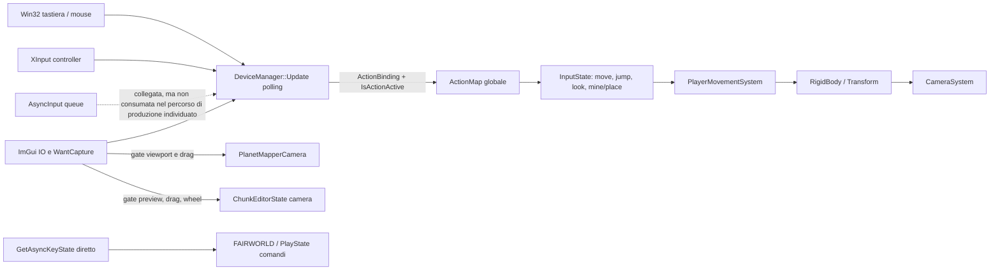
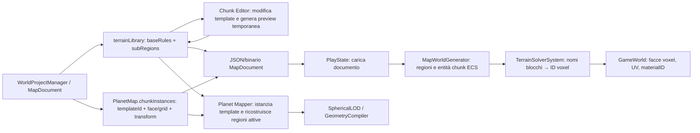

# FAIRWORLD — D1.2.16 Input, Camera & World Data Flow Audit

**Modalità:** audit statico READ-ONLY sui sistemi di produzione. Nessuna GUI, processo grafico o test è stato avviato. Nessun sorgente, shader, asset o salvataggio è stato modificato. Questo documento è l'unico artefatto prodotto.

## Sintesi

- PlayState riceve movimento e salto dalla `ActionMap` tramite `DeviceManager` e `PlayerMovementSystem`, ma parte dell'input dell'applicazione viene ancora letto direttamente con Win32 `GetAsyncKeyState`. La Action Map non è quindi l'unico percorso di input.
- Non esiste una mappa di contesti per azione nel tipo `ActionMap`: i gate dipendono da `requireFreeCursor`, dallo stato ImGui e dal consumer.
- Planet Mapper e Chunk Editor hanno camere orbitali proprie e leggono direttamente lo stato mouse/tastiera di ImGui. PlayState ha una camera in prima persona solidale al rigidbody, con up radiale quando il mondo è sferico.
- Chunk Editor modifica template/regole nel `MapDocument`; Planet Mapper colloca istanze di quei template; PlayState ricostruisce i voxel runtime con `MapWorldGenerator` e `TerrainSolverSystem`. Il documento non trasferisce un payload voxel pronto.
- Nel mesher voxel il blocco numerico diventa `materialID` senza conversione a zero; l'ID 0 è invece trattato come aria e omesso dal meshing. Alcuni generatori di primitive impostano deliberatamente `materialID = 0`.
- I layer shader sono scelti dall'ID materiale interpolato piatto. `TexturePacker` usa fallback colore quando una texture è vuota o non caricabile; `materials.json` include sia percorsi vuoti, percorsi mancanti e almeno un percorso presente. Un rendering GPU corretto/non corretto non è dimostrabile con questa revisione statica.

## 1. Percorso input



### Percorso effettivo e condizioni

| Passaggio | Implementazione | Condizione / comportamento |
| --- | --- | --- |
| Avvio e binding del dispositivo | `src/core/app/main.cpp:270-327` | Crea `DeviceManager`, lo collega al contesto; il loop chiama polling eventi e poi `DeviceManager::Update` (`main.cpp:418-422`). |
| Tastiera e controller | `src/hardware/DeviceManager.cpp:342-393` | Ogni update acquisisce `GetKeyboardState` e interroga XInput; non dipende da eventi `AsyncInput`. |
| Action Map | `src/hardware/InputTypes.h:46-59`; `src/hardware/DeviceManager.cpp:530-619` | È una mappa globale `hash azione → lista di binding`; non contiene contesti o priorità per stato. Default: W/S/A/D e D-pad per movimento, Shift+W corsa, Space/A salto, mouse sinistro distruggi, destro piazza, Esc/Start pausa. `HubState` e `PlayState` la inizializzano solo se vuota (`PlayState.cpp:68`). |
| Risoluzione azione | `src/hardware/DeviceManager.cpp:204-...`, `395-428`, `515-527` | `IsActionActive` risolve il binding fisico. L'update produce `moveForward`, `moveRight`, `isJumping`, `lookYaw/lookPitch`, `isMining/isPlacing`; il salto è rilevato sul fronte di pressione. |
| Gate ImGui e modalità | `src/hardware/DeviceManager.cpp:351-355`, `433-457`; `src/core/app/FAIRWORLD.cpp:497-500` | `m_ignoreGameInput` combina `WantCaptureKeyboard/Mouse` con `requireFreeCursor`; il cursore si sblocca su UI/Esc. `PlayerMovementSystem` salta l'entità se `requireFreeCursor` è true (`Systems.cpp:148`). Il flag è aggiornato dall'engine dopo l'update input nel loop principale, quindi il valore letto da `DeviceManager` può provenire dal frame precedente: ordine verificato nel codice; impatto percepito da misurare runtime. |
| Mouse capture e delta | `src/hardware/DeviceManager.cpp:430-513` | Lock con click sinistro raw quando non è richiesto cursore libero; nasconde il cursore con `ShowCursor`, campiona posizione, la centra con `SetCursorPos` e ricava delta. Esc sblocca. Il gamepad collegato forza il lock. Frecce e stick destro contribuiscono al look. Non è stato trovato un percorso di lock basato su callback GLFW o `ClipCursor`. |
| Consumo nel gioco | `src/systems/Systems.cpp:127-222` | `PlayerMovementSystem` legge `DeviceManager::GetInput()`: yaw/pitch, WASD, corsa e salto. Se non è creativo, Space applica `jumpForce` solo quando `isGrounded`. |
| Letture raw parallele | `src/states/PlayState.cpp:397,485`; `src/core/app/FAIRWORLD.cpp:477,485,530,1733` | F1, B, F5, Esc e hotbar includono `GetAsyncKeyState`; alcune azioni come inventario/diario usano invece `IsActionActive`. Questi comandi non sono tutti governati dallo stesso gate Action Map/ImGui. |
| AsyncInput | `src/hardware/AsyncInput.cpp:15-22`; `src/core/app/main.cpp:326` | È esposto nel contesto. Nell'audit delle chiamate di produzione non sono emerse chiamate a `PushEvent` o `SwapBuffersAndConsume`: la coda non risulta il percorso effettivo per WASD/mouse. |

**Esito A — CONFIRMED:** PlayState usa la Action Map per WASD/Space/look strutturato in `InputState`, ma mantiene input raw separato per altri comandi. Non c'è un action context per stato. **SUSPECTED:** eventuali input UI che sembrano “mangiati” possono dipendere dal gate condizionato a `requireFreeCursor`, dal gate ImGui locale e dall'ordine di aggiornamento del flag; il difetto concreto dipende da una riproduzione che questo audit non esegue.

## 2. Camere e movimento

```mermaid
flowchart TD
    subgraph PM[Planet Mapper]
      PMUI[ImGui mouse + WASD/R/F] --> PMCam[PlanetMapperCamera orbitale]
      PMCam --> PView[SharedContext activeCameraView]
      PView --> PRay[RaycastQuery dalla camera e coordinate viewport]
    end
    subgraph CE[Chunk Editor]
      CEIO[ImGui drag / wheel] --> CECam[Orbit camera preview chunk]
      CECam --> CView[SharedContext activeCameraView]
    end
    subgraph Play[PlayState]
      Input[DeviceManager InputState] --> Move[PlayerMovementSystem]
      Move --> Body[RigidBody position / velocity]
      Body --> CamSys[CameraSystem yaw-pitch + frame locale]
      CamSys --> Transform[Camera Transform]
      Body --> Gravity[PhysicsEngine radial o cartesiana]
    end
```



| Stato | Tipo e pivot | Assi / aggiornamento | Valutazione statica |
| --- | --- | --- | --- |
| Planet Mapper | Orbit camera, target iniziale `(0,0,0)`, distanza iniziale 250; inizializzazione in `PlanetMapperState.cpp` e formule in `PlanetMapperCamera.cpp:117-123,183-201`. | Yaw/pitch e distanza aggiornati con drag/wheel; controlli WASD/arrow/R/F/PGUP/PGDN leggono ImGui (`PlanetMapperCamera.cpp:133-180`). `lookAt(camPos,target,+Y)`. Camera input è ammesso solo quando il mouse non è catturato e `x >= 45%` larghezza (`:133-146`). Il raycast usa il viewport destro 65%, ma è bloccato se una finestra ImGui è hovered (`:203-228`). | La rotazione attorno al target centrale è intenzionale. Non è la camera del giocatore. Capture di ImGui o posizione del puntatore fuori dalla soglia possono impedire drag/raycast. L'effetto concreto resta NOT VERIFIED senza GUI. |
| Chunk Editor | Orbit camera intorno al centro del chunk di preview (`ChunkEditorState.cpp:193-195,293-309`). | Input solo con `!WantCaptureMouse && previewHovered`; right drag orbita, left drag trasla target, wheel zoom solo con `m_zoomModeActive` (`:249-289`). `lookAt(...,+Y)`. | Il pivot è il preview chunk e l'orbita è intenzionale. Il movimento WASD non è instradato dalla Action Map per questa camera. |
| PlayState | Camera in prima persona sul player: camera entity ha `Transform`, `CameraComponent`, `RigidBodyComponent`; lo spawn imposta posizione e orientamento iniziale (`PlayState.cpp:155-220`). | Quando `PlanetGeometryComponent::isLogicalSphere`, up è radiale dal centro; yaw ruota intorno a up, pitch intorno a right. Il movimento avanza/destra sul piano tangente; Space salta lungo up (`Systems.cpp:146-222`). La camera segue posizione rigidbody + eye offset; `CameraSystem` crea la rotazione (`Systems.cpp:15-73`). | Il feeling “il pianeta ruota intorno a me” è compatibile con una visuale locale radiale solidale al player; non prova un pivot errato. Gravità fisica radiale è selezionata dal flag di sfera logica; per mondi flat il percorso fisico usa il frame cartesiano, ma PlayState forza attualmente il flag sferico (vedi sotto). |

**Rischio matematico confermato, effetto runtime non verificato:** `CameraSystem` e `PlayerMovementSystem` costruiscono il riferimento tangente con `cross(up, planetNorth)` se `abs(dot) < 0.99`, e passano a un vettore fisso ±Z altrimenti (`Systems.cpp:54-60,171-179`). La regola è singolare vicino ai poli e cambia ramo sulla soglia 0.99; una discontinuità dell'orientamento è possibile ai lati della soglia. Non è provato che questa sia la causa del sintomo riferito, né che sia un errore rispetto alla convenzione D1.2.

**Incoerenza di configurazione confermata:** dopo aver assegnato `geom.isLogicalSphere = !originalFlat`, PlayState lo sovrascrive subito con `geom.isLogicalSphere = true` (`src/states/PlayState.cpp:321-326`). Di conseguenza il mondo runtime PlayState tratta come sfera logica anche una mappa flat. Questo seleziona frame radiale per movimento/camera e gravità radiale in `src/systems/PhysicsEngine.cpp:60-99`. È un difetto di propagazione del flag verificabile nel sorgente; l'effetto osservato su una mappa flat specifica non è stato provato in runtime.

## 3. Percorso dei dati planetari



1. **Documento:** `MapDocument` persiste `terrainLibrary`, `PlanetMap` (dimensione, base terrain, regioni, istanze e spawn) nei serializer JSON/binary (`src/world/MapDocument.cpp:450-548,587-747,881-1036`). `WorldProjectManager::LoadProject/SaveProject` è il wrapper (`src/world/WorldProjectManager.cpp:89-110`).
2. **Chunk Editor:** `RebuildChunkPreview` prende il template selezionato, costruisce un documento planetario temporaneo flat dai `baseRules` e `subRegions`, invoca `MapWorldGenerator::Generate`, quindi marca i chunk preview dirty (`src/states/ChunkEditorState.cpp:71-...`, generazione a `:184-190`). Le modifiche UI vanno a `doc.terrainLibrary`; non è un trasferimento di voxel serializzati.
3. **Planet Mapper:** combina regioni del pianeta con le istanze attive, cercando `templateId` in `terrainLibrary` e traslando le subregioni sulla griglia dell'istanza (`src/states/PlanetMapperState.cpp:169-221`). Salta a PlayState impostando `targetGameJsonPath = "saves/map/world_map.json"` (`:149-157`).
4. **Generazione runtime:** PlayState ricarica il documento, imposta `PlanetGeometryComponent`, quindi chiama `MapWorldGenerator::Generate(..., limitRadius=160, focusPos=spawnPos)` (`src/states/PlayState.cpp:254-304`). `MapWorldGenerator` espande template/istanze in regioni, crea/riusa entità `VoxelChunkComponent`, assegna coordinate planetarie e `BiomeDataComponent`, poi mette il tag `TerrainGenTag` (`src/world/MapWorldGenerator.cpp:19-...`, in particolare `:35-63,69-127,175-...`).
5. **Voxel:** `TerrainSolverSystem` usa `PlanetChunkCoord` canonica per face/col/row e risolve le regole; `ResolveTerrainRules` converte nomi stringa in ID via `BlockRegistry::GetBlock(name).id` (`src/systems/TerrainSolverSystem.cpp:51-78,97-114`; `src/world/MapDocument.cpp:1346-1358`). `TerrainSolver::ClassifyVoxels` scrive blocchi numerici e usa zero per aria/cave (`src/world/TerrainSolver.cpp:289-328`).
6. **Mesh voxel:** `GameWorld` legge voxel, salta il blocco 0, legge fallback/materiale dal registro, assegna `materialID = block`, genera UV per faccia con `VoxelFaceUV` e normali per faccia (`src/world/GameWorld.cpp:474-...`, `:508-576`). Il dato mesh è ricostruito dai voxel; non è copiato direttamente dal documento.
7. **Percorso LOD:** Planet Mapper aggiorna la propria `SphericalLODSystem` durante preview (`PlanetMapperState.cpp:214-225`). PlayState chiama `RebuildPlanetRoots`, ma ha commento esplicito che l'independent LOD terrain è stato rimosso e che solo voxel chunks sono authoritative (`PlayState.cpp:454`); il callsite `RebuildPlanetRoots` a `:304` da solo non dimostra che una mesh LOD venga emessa o renderizzata. Le mesh LOD non sono quindi prova sostitutiva di una mesh voxel runtime.

**CONFIRMED:** i dati del Chunk Editor diventano regole di template e la loro applicazione nel mondo di gioco passa da generazione e classificazione voxel. **NOT VERIFIED:** quale contenuto effettivo raggiunga GPU in una specifica sessione, se ogni chunk richiesto venga prodotto e se i salvataggi contengano le regole attese; non sono stati caricati salvataggi né avviato il runtime.

## 4. Materiali, ID, UV e texture

```mermaid
flowchart LR
    BR[BlockRegistry: nomi ↔ block ID]
    MR[MaterialRegistry: indice/target_block_id ↔ PBR definition]
    Rules[MapDocument blockName]
    Rules -->|GetBlock(name).id| BR
    BR --> Voxel[VoxelChunk uint8 block]
    Voxel -->|nonzero block| Mesher[GameWorld mesher]
    MR -->|fallback color / PBR| Mesher
    Mesher -->|Vertex UV + materialID| Vertex[fw::Vertex]
    Vertex -->|loc 2 UV; loc 3 uint material ID| Shader[forge.vert / forge.frag]
    MR --> Packer[TexturePacker arrays]
    Packer -->|array layer index| Shader
```

| Caso statico | Risoluzione e mesh | Risultato shader/layer documentato | Stato |
| --- | --- | --- | --- |
| ID 0 | Air ID 0 è il default in classificazione voxel (`TerrainSolver.cpp:290,307`) e il mesher voxel omette `block == 0` (`GameWorld.cpp`, condizione nel loop mesh). Non esiste quindi una superficie voxel ID 0 da usare per concludere il colore dell'aria. `MakeVoxelPreview(0)` può costruire un preview con `materialID=0` (`MeshGenerators.cpp:55-80`). | `CacheManager::SyncAllMaterialsGpuCache` salta l'indice 0 (`CacheManager.cpp:50-57`); lo shader clamperebbe un ID fornito al numero di layer disponibile (`forge.frag:122-125`). Il percorso della preview ID0 non prova l'aspetto di aria in un chunk. | **CONFIRMED** gestione ID0; colore GPU effettivo **NOT VERIFIED**. |
| Fallback colorato noto: ID 1 (Grass) | Il registro ha fallback verde `(0.2,0.8,0.2)` in default (`MaterialRegistry.cpp:23-30`); `materials.json` per ID1 ha `albedoPath` vuoto e fallback `(0.3,0.8,0.2)` (`materials.json:24-41`). Il mesher assegna `materialID=block` e prende `baseColorFallback` (`GameWorld.cpp:508-512`). | `TexturePacker` costruisce albedo fallback dai componenti colore quando il path è vuoto (`TexturePacker.cpp:306-314`); cache GPU può aggiornare il fallback senza caricare albedo (`CacheManager.cpp:58-62`). Shader campiona la layer del material ID (`forge.frag:122-137`). | Percorso CPU **CONFIRMED**; colore effettivamente osservato GPU **NOT VERIFIED**. |
| Texture albedo valida: ID 17 | `materials.json` associa ID17 alla texture `textures/blocks/fairworld_carburotitanio_albedo.png` (`materials.json:344-361`); il file esiste nel checkout. `ResolveTerrainRules`/mesher conserva l'ID numerico una volta risolto. | `CacheManager` carica il path nella layer con indice ID (`CacheManager.cpp:50-69`); `TexturePacker` costruisce gli array nello stesso ordine del vettore materiali (`TexturePacker.cpp:144-...`); `forge.frag` usa `inUV` e `inMaterialID` come coordinate e layer (`:122-137`). | Esistenza e collegamento statico **CONFIRMED**; caricamento e resa GPU **NOT VERIFIED**. |

### Conversioni, fallback e punti di rischio materiale

- `BlockRegistry::GetBlock(string)` restituisce un blocco fallback ID 255 se il nome non esiste (`src/blocks/BlockRegistry.cpp:576-586`); la funzione distinta `GetBlockIdByString` restituisce invece 0 (`:589-599`). Nel percorso di `ResolveTerrainRules` esaminato viene usato `GetBlock(...).id`, non `GetBlockIdByString`. Quindi non è dimostrata una conversione da nome invalido a zero in questo percorso; è invece dimostrato il fallback 255.
- `TerrainSolver` assegna ID 0 per aria sopra superficie e per celle scavate; ciò è una semantica voxel, non un errore di conversione del materiale.
- `GameWorld` mantiene l'ID del blocco come `materialID`; non è emersa una sostituzione con zero nel mesher voxel. `MeshGenerators::MakeVoxelPreview` conserva `blockId` (`MeshGenerators.cpp:55-80`). Al contrario, `MakeSphere`/`MakeSuperSphere` impostano esplicitamente `materialID=0` (`:99-121,145-190`), mentre `GeometryCompiler::CreateVertex` inizializza a zero (`GeometryCompiler.cpp:22-33`) ma le superfici compiler possono sovrascrivere il campo con `sc.materialId`/`resolvedMatId` (`:160,2691`). Sono default/producer distinti e non provano che un ID già assegnato venga perso nel percorso voxel.
- Il contratto Forge usa location 2 come UV e location 3 come `uint materialID` (`src/render/forge.vert:15-16,47-62`, `src/render/forge.frag:6-7,122-137`). Le UV voxel sono generate in funzione di posizione e normale (`VoxelFaceUV.h`, chiamata nelle sei facce di `GameWorld.cpp:521-576`).
- L'asset tree contiene `fairworld_Grass_albedo.png`, ma il record ID1 in `materials.json` non lo referenzia: il percorso globale PBR del registro e il percorso asset standalone della Block Maker possono quindi divergere. Block Maker invoca `LoadPBRTextureFromFile` usando la path selezionata e l'ID selezionato (`src/states/BlockMakerState.cpp:8584`); questo non modifica automaticamente `materials.json` né prova che PlayState usi la stessa texture.
- In `materials.json`, gli ID6 e ID12 hanno percorsi albedo non vuoti ma i corrispondenti file `fairworld_Water_albedo.png` e `fairworld_thesims_albedo.png` non risultano presenti; ID17 ha invece path presente. Il caricamento di una path mancante e il fallback effettivamente mostrato dipendono dall'esito runtime/texture cache e non sono dichiarati causa confermata di un sintomo visivo.
- `TexturePacker` crea fallback per albedo, normal e ORM (`TexturePacker.cpp:292-315`); fallback magenta generico appare solo nella configurazione statica iniziale della funzione, mentre fallback albedo per materiale viene calcolato dal colore PBR. Quale ramo si usi per una cache esistente va verificato con log/cache runtime, non inferito dall'aspetto.

## 5. Matrice sintomo → collegamento → stato

| Sintomo / domanda | Producer | Consumer | Collegamento | Evidenza statica | Ipotesi / stato |
| --- | --- | --- | --- | --- | --- |
| WASD/Space non muove il player | polling e Action Map in `DeviceManager` | `PlayerMovementSystem` | `InputState` via `DeviceManager::GetInput` | `DeviceManager.cpp:407-428`; `Systems.cpp:146-213` | Movimento cablato. Interferenza di gate, stato grounded o velocità **NOT VERIFIED** senza runtime. |
| Tasti rispondono in modo diverso tra gioco e UI | Win32 polling, ImGui e `requireFreeCursor` | `DeviceManager`, engine, state | gate globale più controlli raw separati | `DeviceManager.cpp:351-355`; `FAIRWORLD.cpp:497-530` | Contesti non uniformi e raw polling confermati; quale percorso generi il sintomo è **SUSPECTED**. |
| Mouse look non funziona o salta | OS cursor/delta | `InputState.lookYaw/lookPitch` → `PlayerMovementSystem` | centratura Win32, sensibilità applicata al consumer | `DeviceManager.cpp:459-513`; `Systems.cpp:152-158` | Dipende da lock, HWND, gate UI e stato `m_firstMouse`; causa del caso utente **NOT VERIFIED**. |
| Camera che orbita “come il pianeta” in editor | mouse/keyboard ImGui | PlanetMapperCamera / ChunkEditorState | yaw/pitch attorno a target chunk/centro | `PlanetMapperCamera.cpp:148-201`; `ChunkEditorState.cpp:264-309` | Camera orbitale intenzionale **CONFIRMED**; non è la camera PlayState. |
| Player ruota con la superficie | mouse look e rigidbody | PlayerMovementSystem + CameraSystem | frame radiale e tangent frame | `Systems.cpp:41-73,162-179` | Up radiale intenzionale **CONFIRMED**; discontinuità vicino alla soglia polare è rischio statico; relazione col sintomo **SUSPECTED**. |
| Mappa flat si comporta da sfera in PlayState | `PlanetMap.isFlat` | `PlanetGeometryComponent` letto da camera, movimento e fisica | `PlayState` copia il flag e lo sovrascrive | `PlayState.cpp:321-326`; `PhysicsEngine.cpp:60-99`; `Systems.cpp:25-33,136-143` | Sovrascrittura a `true` **CONFIRMED**; impatto runtime su documento flat **SUSPECTED** finché non eseguito. |
| Pianeta visibile ma raycast non seleziona terreno | query RaycastMode::Voxel | `RaycastSystem::Cast` / hit | viewport gates + entità/chunk voxel registrati | `PlanetMapperCamera.cpp:203-...`; statistiche raycast in `:...` | Visibilità del pianeta non implica target voxel; presenza e registrazione runtime non verificabili in questo audit: **NOT VERIFIED**. |
| World map non produce il contenuto atteso in PlayState | template/regole e chunkInstances | MapWorldGenerator → TerrainSolver → GameWorld | risoluzione templateId, nomi blocchi, generazione locale | `MapWorldGenerator.cpp:35-63,69-...`; `TerrainSolverSystem.cpp:97-114`; `TerrainSolver.cpp:289-328` | Rebuild documentale→voxel confermato. Dati specifici persistiti o chunk generati **NOT VERIFIED**. |
| Blocchi grigi / texture mancanti | `materials.json`, registry, texture cache | ID layer + shader Forge | ID materiale → layer; UV → campionamento | `MaterialRegistry.cpp`; `CacheManager.cpp:50-69`; `forge.frag:122-137` | Percorsi vuoti/mancanti e fallback sono reali; attribuzione del grigio senza dati GPU/cache **NOT VERIFIED**. |
| Material ID diventa 0 | producer mesher / primitive | fragment shader layer | campo `Vertex.materialID` | voxel mesher usa ID blocco; primitive sphere impostano 0 | Nessuna sostituzione a zero trovata nel percorso document→voxel→mesher; producer di primitive con zero è **CONFIRMED**, rilevanza per i blocchi del mondo **NOT VERIFIED**. |

## 6. Problemi confermati, sospetti e non verificati

### CONFIRMED (codice)

1. Action Map globale senza contesti per stato; gate ImGui e `requireFreeCursor` vivono fuori dal modello dei binding.
2. PlayState usa InputState/Action Map per movimento, salto e look, ma alcuni comandi sono raw Win32.
3. Lock del mouse e delta dipendono dalla gestione cursor di `DeviceManager`; editor ha anche input diretto da ImGui.
4. Le tre camere hanno ruoli distinti: due orbitali nei tool, prima persona radiale nel gameplay.
5. I dati del Chunk Editor sono template/regole; il mondo PlayState li espande e rigenera in voxel ECS. Non c'è passaggio diretto del payload mesh/voxel del preview.
6. PlayState imposta sempre `isLogicalSphere=true` dopo aver letto `isFlat`; il dato sferico/flat del documento viene quindi perso per la logica runtime. La gravità lo consuma.
7. Il mesher voxel assegna `materialID` uguale al byte blocco non-zero e UV per faccia. ID0 è aria e viene escluso dalla mesh voxel.
8. Il resolver usa fallback ID255 per nomi blocco ignoti; un helper separato `GetBlockIdByString` ritorna 0, ma non è il helper usato nel percorso regole controllato.
9. I dati di configurazione materiale mostrano path vuoti, path mancanti e un asset ID17 presente. L'esistenza del file ID17 è una verifica filesystem read-only, non una prova di upload GPU.

### SUSPECTED

1. Il flag `requireFreeCursor` aggiornato dopo `DeviceManager::Update` può creare un frame di ritardo quando si entra/esce da UI; non è stata verificata la percezione né l'effetto sul singolo tasto.
2. La base tangente della camera/movimento cambia formula alla soglia `abs(dot(up,north)) = 0.99`; può produrre un salto d'orientamento per certi punti latitudinali. Non è dimostrato che corrisponda a una direzione o bug osservato.
3. La differenza tra path globale registry e path selezionata da Block Maker può far divergere preview e materiale runtime; serve verificare quale ID e quale layer siano effettivamente aggiornati.
4. Una camera orbitale dei tool può essere descritta come “il pianeta gira” perché il globo è l'oggetto osservato attorno al pivot; nessun errore di pivot è dimostrato dal codice esaminato.

### NOT VERIFIED

- Interazione reale con ImGui, mouse delta, latenza percepita e priorità input.
- Orientamento osservato e continuità al passaggio della soglia polare.
- Numero e stato delle entità voxel/raycast registrate durante una sessione.
- Material ID e UV effettivamente presenti nei buffer GPU, layer effettivamente caricato, risultato texture cache e pixel finali.
- Integrità/valori dei documenti utente e contenuto del mondo dopo un avvio specifico.
- Presenza di mesh voxel in una scena PlayState specifica; il sorgente genera i chunk richiesti ma non prova una sessione runtime completata.

## 7. Dipendenze mancanti e raccomandazioni minime

Le raccomandazioni sono proposte per una fase successiva e non sono state applicate.

1. **Input:** acquisire una traccia read-only per un caso riproducibile che includa stato `WantCaptureKeyboard/Mouse`, `requireFreeCursor`, lock, `InputState` e action attiva nello stesso frame. Dopo tale evidenza valutare un punto unico di routing e contesti per stato; evitare di cambiare binding prima di sapere quale gate fallisce.
2. **Mouse:** strumentare in modo aggregato il transitione lock/unlock, coordinate cursore, centro finestra, delta e `m_firstMouse`; validare focus/minimizzazione e `ClientToScreen` senza alterare input.
3. **Camera orbitale:** confrontare numericamente target, posizione e `cameraFront` in Planet Mapper/Chunk Editor; se il sintomo è in PlayState, registrare radiale up, dot con north, ramo tangent-frame, yaw/pitch, rigidbody e rotazione camera. Una futura correzione ai poli dovrebbe definire un frame tangente continuo e testarlo senza cambiare CubeSphereMapping/D1.2.
4. **Flag geometria PlayState:** verificare la semantica prevista per mappe flat e rimuovere in una patch autorizzata la sovrascrittura incondizionata del flag; testare camera, movimento e gravità sia flat sia sferici.
5. **World transfer:** in un fixture isolato confrontare ID template, conteggio istanze, face/grid/transform, regole blocco, chunk ECS creati, `BiomeDataComponent`, voxel non-zero e mesh prodotte nei tre stati. Separare document state, preview state e runtime state.
6. **Materiali:** per un ID di test registrare `blockName → BlockRegistry id → MaterialRegistry[target_block_id] → Vertex.materialID/UV → layer/cache status`. Validare separatamente ID0 (aria), ID1 (fallback verde) e ID17 (albedo presente); non usare un globo grigio come unico criterio.
7. **PBR paths:** verificare che il path asset sia risolto rispetto alla root runtime prevista e che il caricamento fallito produca il fallback desiderato. In particolare confrontare `materials.json` e asset realmente referenziati; non modificare TexturePacker v2 o UV Forge durante la diagnosi.

## 8. Riferimenti sorgente principali

- Input: `src/hardware/InputTypes.h`, `src/hardware/DeviceManager.cpp`, `src/hardware/AsyncInput.cpp`, `src/core/app/main.cpp`, `src/core/app/FAIRWORLD.cpp`.
- Camera/movimento: `src/states/components/PlanetMapperCamera.cpp`, `src/states/ChunkEditorState.cpp`, `src/states/PlayState.cpp`, `src/systems/Systems.cpp`.
- Dati: `src/world/MapDocument.cpp`, `src/world/WorldProjectManager.cpp`, `src/world/MapWorldGenerator.cpp`, `src/systems/TerrainSolverSystem.cpp`, `src/world/TerrainSolver.cpp`, `src/world/GameWorld.cpp`.
- Materiali: `src/blocks/BlockRegistry.cpp`, `src/blocks/MaterialRegistry.cpp`, `src/render/TexturePacker.cpp`, `src/core/memory/CacheManager.cpp`, `src/render/forge.vert`, `src/render/forge.frag`, `assets/definitions/materials.json`, `src/world/VoxelFaceUV.h`.

**Conclusione:** l'architettura sorgente rende tracciabili i percorsi principali, ma i sintomi visuali/materiali e i malfunzionamenti effettivamente percepiti non possono essere attribuiti definitivamente senza log di una sessione controllata. D1 resta in revisione; questo audit non propone né dichiara freeze.
