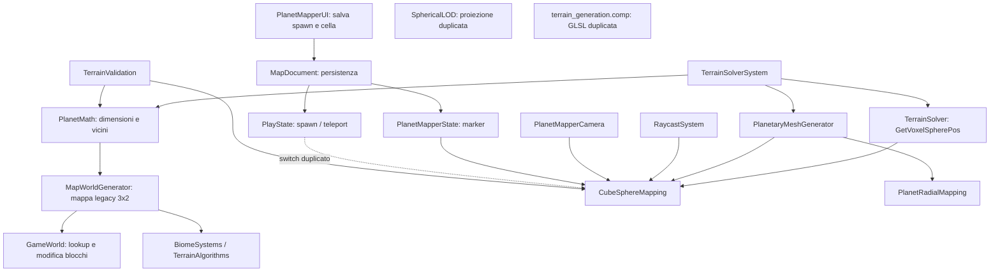

# D1 — PlanetMath & CubeSphereMapping Audit

**Stato:** FOUNDATION — FROZEN; P0.3C3 — FROZEN; D1 — START / READ-ONLY  
**Ambito:** audit statico delle conversioni planetarie e dei loro chiamanti.  
**Esito:** nessun sorgente modificato; nessun test o build eseguito in questo audit. Questo documento è l'unico file creato. Le affermazioni sono etichettate come fatti verificati, rischi/ipotesi o raccomandazioni.

## Sintesi

**FATTO VERIFICATO — incoerenza spawn point:** la UI salva `localZ/R = 2v-1`, mentre entrambi i consumatori interpretano `localZ/R` come `cy = 1-2v`. Per un dato UV la ricostruzione riflette quindi la coordinata verticale della faccia (`v` diventa `1-v`). È una discrepanza algebrica nei percorsi `PlanetMapperUI` → `PlanetMapperState` e `PlayState`; l'audit statico non afferma di aver osservato l'effetto in esecuzione.

**FATTO VERIFICATO — orientamento griglia discordante:** `CubeSphereMapping` e `PlanetaryMeshGenerator` usano la convenzione UV con `v` crescente verso il basso (`cy=1-2v`). Le conversioni legacy in `MapWorldGenerator` trattano invece il loro asse locale `cy`/indice `cz` come crescente verso il nord/alto della faccia. Le coordinate di blocco derivate dal mondo possono quindi selezionare una riga diversa da quella prodotta dal mesh mapping, a parità di posizione sulla faccia. È una divergenza di formule; impatto runtime da confermare con un test d'integrazione.

**FATTO VERIFICATO — copertura dei test sovrastimata:** alcune righe stampate come PASS sono costanti `true`; i test di continuità dei campi generano i chunk ma ritornano `true` senza confrontarne i campi. I test D4 contengono controlli matematici utili, ma i test invalid-input non falliscono sul caso degenerato.

**RACCOMANDAZIONE:** prima di D2, approvare un contratto unico per orientamento di faccia, UV, griglia, spawn e offset radiale; poi aggiungere test di equivalenza fra le implementazioni esistenti. Non applicato in questo audit.

## 1. Inventario di file e funzioni

| File | Funzioni/elementi rilevanti | Ruolo verificato |
|---|---|---|
| `src/core/utils/PlanetMath.h` | `CubeFace`, `FaceEdge`, `PlanetSize`, `GetFaceResolution`, `GetPlanetRadius`, `GetEditorCanvasExtents`, `GetNeighborCrossFace`, `ResolveNeighbor`; `PlanetChunkCoord` | Identità e dimensioni planetarie, transizioni fra chunk di facce. |
| `src/core/utils/ChunkDimensions.h` | dimensioni voxel/chunk e `RadialOriginVoxel` | Scala della griglia e origine radiale dichiarata. |
| `src/world/CubeSphereMapping.h/.cpp` | `DirectionToFaceUV`, `FaceUVToCubeDir`, `FaceUVToDirection`, `UVToGrid`, `GridToUV`, `CellToDirection`; overload legacy `int` e alias `FaceUVToCell` nell'header | Mapper canonico C++ per proiezione cubica e sfera. |
| `src/world/PlanetRadialMapping.h/.cpp` | conversioni layer/offset/raggio, classificazione dominio radiale | Convenzione radiale usata dal generatore planetario. |
| `src/world/TerrainSolver.cpp` | `GetVoxelSpherePos` | Mappa i campioni del terrain solver su direzione e raggio. |
| `src/world/PlanetaryMeshGenerator.cpp` | `ConvertToPlanetaryPositions` | Trasforma vertici di chunk planetari usando mapper canonico e offset radiale. |
| `src/world/MapWorldGenerator.cpp/.h` | `Generate`, `GetSphericalChunkTransform`, `GetTrueSphericalPosition`, `WorldToVoxelCoord`, `GetChunkCoordFromPosition` | Generazione e coordinate del mondo mappa 3×2; include proiezioni indipendenti dal mapper canonico. |
| `src/world/GameWorld.cpp` | chiamate a `WorldToVoxelCoord` nei percorsi `GetBlockCartesian`, `GetBlock`, `SetBlock` | Usa il mapping legacy per interrogare/modificare blocchi nello spazio mondo. |
| `src/systems/TerrainSolverSystem.cpp` | costruzione del contesto terreno con `PlanetChunkCoord` | Collega coordinate di chunk al generatore. |
| `src/systems/RaycastSystem.cpp` | `CastSphere` e conversione hit tramite `DirectionToFaceUV` | Converte gli hit sferici in faccia/UV canonici. Il chiamante PlanetMapper indicato usa il percorso voxel, perciò `CastSphere` non è dimostrato come suo percorso effettivo. |
| `src/states/components/PlanetMapperCamera.cpp` | aggiornamento hit → `DirectionToFaceUV` | Proietta la normale della hit in coordinate canoniche della faccia. La posizione è normalizzata assumendo il centro del pianeta all'origine. |
| `src/states/components/PlanetMapperUI.cpp` | salvataggio spawn da `lastRayHit.uv`; conversione locale per cella/chunk | Scrive i componenti locali dello spawn e prepara coordinate di cella. |
| `src/states/PlanetMapperState.cpp` | ricostruzione marker spawn | Rilegge `localX/localZ` come coordinate `cx/cy` della chart. |
| `src/states/PlayState.cpp` | spawn iniziale e teletrasporto da spawn point | Duplica il mapping delle sei facce e interpreta `localZ/R` come `cy`. |
| `src/world/MapDocument.cpp/.h` | caricamento/salvataggio `faceIndex`, `gridX/Y`, `localX/Z` | Persistenza; la validazione ripara i limiti di griglia ma non valida esplicitamente `faceIndex`. |
| `src/world/SphericalLOD.cpp` | conversione normale → faccia/cella | Seconda implementazione della proiezione dominante e delle coordinate di faccia. |
| `src/render/shaders/terrain_generation.comp` | GLSL `normalToFaceUV` e proiezione dei vertici | Implementazione GPU parallela; non risulta coperta da un confronto automatico con C++. |
| `src/world/terrain/validation/TerrainValidation.cpp/.h` | continuity, gate D2/D3/D4 | Test esistenti, soglie e limiti descritti nella sezione 7. |
| `src/core/app/GameplayLifecycleStressTests.cpp` | esercizio di `GetNeighborCrossFace` | Smoke path: risultato calcolato ma non asserito. |
| `src/states/ChunkEditorState.cpp` | conversione canvas 2D ↔ chunk | Usa un canvas centrato; non è la chart UV delle facce planetarie e non va mescolato con la convenzione `v` cubica. |

### Dipendenze

Le frecce continue rappresentano dipendenze/percorsi chiamante verificati nel codice; quelle tratteggiate indicano formule parallele/duplicate, non un'importazione di `CubeSphereMapping`.

## 2. Convenzioni e formule effettivamente implementate

### 2.1 Indici, dimensioni e raggio

`CubeFace` assegna gli indici `+Z=0, -Z=1, +X=2, -X=3, +Y=4, -Y=5`. La mappa 3×2 legacy usa `face_col=face%3`, `face_row=face/3`, che colloca le prime tre facce nella riga superiore e le restanti tre in quella inferiore.

Le risoluzioni sono Tiny 3, Micro 5, Small 7, Medium 11, Large 21, Huge 41. `PlanetMath::GetPlanetRadius` restituisce `N * (HorizontalWorldExtent/2)`; con estensione orizzontale 16 è `R=8N`. `GetEditorCanvasExtents` è `(N-1)/2`, quindi è un helper per coordinate centrate e non una conversione UV.

### 2.2 Direzione ↔ faccia/UV canoniche

Per direzione `d=(x,y,z)`, si seleziona il valore massimo di `(|x|,|y|,|z|)`, con priorità in caso di parità **Z, poi X, poi Y**: le condizioni C++ usano `>` e partono da Z. Il segno sceglie la faccia. Non è richiesta la normalizzazione prima della proiezione perché si divide per l'asse dominante.

Posti `p=d/max(|x|,|y|,|z|)`, le coordinate chart `(cx,cy)` sono:

| Faccia | `cx` | `cy` | `FaceUVToCubeDir` |
|---|---:|---:|---|
| +Z | `p.x` | `p.y` | `(cx, cy, 1)` |
| -Z | `-p.x` | `p.y` | `(-cx, cy, -1)` |
| +X | `-p.z` | `p.y` | `(1, cy, -cx)` |
| -X | `p.z` | `p.y` | `(-1, cy, cx)` |
| +Y | `p.x` | `-p.z` | `(cx, 1, -cy)` |
| -Y | `p.x` | `p.z` | `(cx, -1, cy)` |

La chart C++ converte con `u=(cx+1)/2`, `v=(1-cy)/2`; quindi U cresce verso destra e V cresce verso il basso rispetto a `cy`. `FaceUVToDirection` normalizza il vettore di faccia. I centri delle sei facce puntano lungo i rispettivi assi cartesiani positivi/negativi.

### 2.3 UV ↔ griglia ↔ direzione

Per risoluzione `N`, `UVToGrid` calcola `(int)(u*N)` e `(int)(v*N)`, poi limita ogni indice in `[0,N-1]`; per UV finite nel dominio ciò equivale al contenitore a pavimento, con `u=1`/`v=1` assegnati all'ultima cella. `GridToUV` restituisce il centro `(col+0.5)/N, (row+0.5)/N`. `CellToDirection` compone centro cella e proiezione sferica.

`PlanetaryMeshGenerator` usa `u=(chunk.col*VoxelsX+pos.x)/(N*VoxelsX)` e analogo `v` da `row`/`pos.z`, poi `FaceUVToDirection`. `TerrainSolver::GetVoxelSpherePos` usa analogamente `(chunkCoord.x*voxelResolutionX+x)/faceGridResolution` e `(chunkCoord.z*voxelResolutionZ+z)/faceGridResolution`; non aggiunge mezzo voxel. Questo è compatibile con campionamento ai vertici/bordi condivisi, ma il commento di campionamento “centro” o le aspettative di altri chiamanti andrebbero verificati: il codice da solo non dimostra quale discretizzazione fosse voluta.

### 2.4 Transizioni ai bordi

`GetNeighborCrossFace` contiene una tabella esplicita per le 24 combinazioni faccia/bordo, con inversioni `N-1-edgePos` dove necessarie. Il controllo manuale di ogni voce rispetto alla chart descritta sopra non ha trovato un'inversione errata evidente. Questa verifica statica non sostituisce un test esaustivo reciproco.

`ResolveNeighbor` gestisce solo un passo cardinale; diagonali sono assertite e in build senza assert restituiscono la coordinata originale. Non verifica che la coordinata di partenza sia nell'intervallo della faccia. La risoluzione del solo bordo non definisce una policy per attraversamento simultaneo di due bordi/corner.

### 2.5 Coordinate legacy 3×2 e raggio

`MapWorldGenerator::GetTrueSphericalPosition` costruisce una posizione locale per ciascuna faccia con formule cubiche equivalenti nella forma alle sei facce, poi normalizza e applica `radiusAtY = R + (local_y - 25)`. `WorldToVoxelCoord` e `GetChunkCoordFromPosition` duplicano i rapporti direzionali faccia per faccia: per asse locale verticale usano `normal.y/normal.z` su ±Z e ±X; per ±Y usano `normal.z/normal.y` con segno specifico. Le righe `cy/cz` aumentano con `local_cy` positivo.

**FATTO VERIFICATO:** in questa conversione legacy il `cy` positivo corrisponde al vettore locale “su” (+Y sulle facce laterali); nella chart canonica invece un `cy` positivo equivale a `v` minore, cioè la riga superiore. `PlanetaryMeshGenerator` incrementa `row` e quindi `v`, spostandosi verso `cy` negativo. Le due direzioni di incremento di riga sono opposte. `GameWorld` usa `WorldToVoxelCoord` per lookup e modifica blocchi, mentre il nuovo mesh mapping usa `PlanetChunkCoord.row` → `v` canonica: questa connessione rende la divergenza rilevante, ma l'esatta manifestazione sul layout generato richiede test d'integrazione.

`PlanetRadialMapping` dichiara `ReferenceVoxelOffset=64` e implementa `g=layer*128+localY-64`, `r=R+g*VoxelWorldSize`; l'inversa continua usa `floor((g+64)/128)` e quella discreta gestisce esplicitamente divisioni negative. La formula legacy usa invece offset `25`. `ChunkDimensions.h` dichiara `RadialOriginVoxel=64`, perciò l'offset 25 è una seconda convenzione non allineata ai nomi/mapper più recenti. Non assumere che le due API siano intercambiabili senza migrazione e compatibilità documentata.

## 3. Invarianti da mantenere

1. Per ogni direzione finita non nulla, `DirectionToFaceUV` deve produrre faccia valida e UV finite, nel quadrato chiuso `[0,1]^2`.
2. Per ogni faccia valida e UV nel quadrato, `FaceUVToDirection` deve essere un vettore unitario e riflettere la stessa direzione: `DirectionToFaceUV(FaceUVToDirection(face,uv))` può restituire una faccia differente sui confini per la tie-break, ma la direzione ricostruita deve coincidere entro tolleranza.
3. Ogni regola di orientamento deve definire una volta sola: asse U, asse V/riga, segni e tie-break; consumer, shader, mapper e dati persistiti devono rispettarla.
4. Centro faccia e assi destra/basso devono corrispondere ai sei orientamenti tabulati sopra.
5. Gli edge transition devono restituire celle in `[0,N)`, essere geometricamente adiacenti e avere inversa reciproca per ogni indice e risoluzione ammessa.
6. Una coordinata di bordo/corner condivisa deve avere policy deterministica anche quando più facce sono valide; non si deve confondere tie-break direzionale con risoluzione di vicinato chunk.
7. Conversione UV/cella deve specificare se coordinate rappresentano vertici, centri di cella o voxel; non mescolare `N` celle con `N+1` campioni senza contratto.
8. L'inversa radiale deve round-trip layer/localY anche per valori negativi e sui confini `0/128`, con regola di floor dichiarata.
9. Input non validi (direzione zero/non finita, face enum invalido, `N<=0`, indici fuori range, raggio non finito, posizione all'origine) devono essere rifiutati/gestiti in modo definito, non trasformarsi silenziosamente in NaN, UB o valori sentinella ambigui.
10. Spawn point: salva e ricarica gli stessi `face`, coordinate locali e direzione; JSON e binario devono preservare lo stesso contratto.

## 4. Problemi dimostrati, rischi e lacune

### 4.1 Problemi dimostrati dal codice

- **Segno spawn verticale discordante.** `PlanetMapperUI.cpp` salva `localV=(2v-1)` e `localZ=localV*R`. `PlanetMapperState.cpp` e `PlayState.cpp` assegnano `cy=localZ/R` e lo convertono con `v=(1-cy)/2` (o switch equivalente). Quindi `v_out=1-v_in`. Esempio: UV `v=0.25` viene salvato come `cy=-0.5`, poi ricostruito a `v=0.75`. La serializzazione mantiene quel valore, ma non corregge la semantica.
- **Orientamento righe divergente fra mapping legacy e canonico.** Le formule e i percorsi chiamanti descritti nella sezione 2.5 provano che gli assi di riga hanno verso opposto. È dimostrato come incoerenza matematica, non come specifico bug visivo osservato.
- **D3 stampa PASS per controlli costanti.** In `RunD3CubeSphereSSOTGateTest` orientamenti facce, UV/grid, rimozione duplicati, regression e build sono stampati con `true`; solo il controllo core descritto nel codice contribuisce a `coreOk`.
- **Test campo continuità non asseriscono la continuità.** `TestIntraFaceField` e `TestCrossFaceField` generano chunk e poi restituiscono `true` senza confrontare i voxel/campi.
- **Test invalid-input D4 non rileva il risultato invalido.** `TestD4InvalidInputs` passa direzione zero, annota il comportamento NaN ma ritorna `true`; inoltre non entra in `coreOk` D4.

### 4.2 Rischi e condizioni non validate

- `DirectionToFaceUV(0)` divide per `maxAxis=0`; input NaN/Inf e conversioni float→int non sono validate. Per zero si osserva aritmeticamente una divisione indefinita; il valore finale concreto dipende da IEEE/GLM/toolchain.
- `FaceUVToCubeDir` usa switch senza default esplicito: face enum invalido lascia il vettore nullo; la successiva normalizzazione in `FaceUVToDirection` non è valida.
- `UVToGrid` presume `resolution>0`, UV finite e conversione int rappresentabile; `GridToUV` divide per la risoluzione senza controllo e non verifica indici. `std::clamp` con limite superiore `resolution-1 < 0` non è un contratto valido per N=0.
- `GetFaceResolution` usa 11 come fallback per un `PlanetSize` non valido. È robusto come fallback ma può mascherare enum corrotti.
- `ResolveNeighbor` non verifica coordinate iniziali; debug assert soltanto su offset non cardinale; fallback di release restituisce la coordinata originale. `GetNeighborCrossFace` valida l'edgePos con assert e sentinella, ma non verifica esplicitamente enum invalidi quando gli assert sono disabilitati.
- `GetChunkCoordFromPosition` normalizza `worldPos` senza guardia sull'origine. `WorldToVoxelCoord` calcola prima `out_localY`, poi ha guardia sulla distanza, ma non definisce un risultato di errore esplicito.
- `MapDocument` conserva `faceIndex` da JSON/binario; la validazione individuata controlla `gridX/Y`, non `faceIndex`. Dato che i mapper hanno comportamento nullo per face invalida, documenti corrotti possono condurre a geometria degenerata. Rischio condizionale, non repro runtime.
- `PlanetaryMeshGenerator` non valida face/col/row finché costruisce UV; la validazione radiale controlla `r>0`, non `isfinite(r)`. `PlanetRadialMapping` esegue `layer*128` e somme `int32_t` prima della conversione float nei metodi discreti; overflow intero non è gestito.
- Le coordinate `GetTrueSphericalPosition` usano divisione e resto C++ con troncamento verso zero; gli indici globali negativi non sono esplicitamente rifiutati prima di derivare faccia/cella.
- Le implementazioni CPU C++, GLSL, LOD e legacy 3×2 duplicano selezione faccia e segni. Anche quando tie-break/formula sembrano coincidere, non esiste nel codice ispezionato una prova automatica di equivalenza.
- Sulle direzioni esattamente a spigolo/angolo la tie-break CPU è deterministica grazie a `>` e priorità Z>X>Y. Non è provato che ogni altra implementazione mantenga identica politica per tutte le precisioni; il test GPU-vs-CPU manca.

## 5. Dipendenze dai chiamanti esistenti

- **PlanetMapper:** la camera produce face/UV canonici; UI converte UV in dati spawn; `PlanetMapperState` ricostruisce marker tramite `CubeSphereMapping`. La discrepanza spawn è direttamente all'interno di questo flusso.
- **PlayState:** usa lo stesso dato spawn ma ha una seconda implementazione delle sei formule. Questo crea sia la discrepanza verticale sia rischio di divergenza futura rispetto al mapper canonico.
- **Raycast:** `RaycastSystem::CastSphere` calcola UV canonici per un'intersezione sferica; il percorso PlanetMapperCamera individuato usa query voxel e normalizza la hit rispetto all'origine. Il centro pianeta assunto all'origine è una precondizione implicita.
- **Terrain/mesh:** `TerrainSolver` genera posizioni tramite `CubeSphereMapping`; `TerrainSolverSystem` passa coordinate planetarie; `PlanetaryMeshGenerator` trasforma vertici usando `row→v`. La generazione legacy e `GameWorld` fanno lookup/mutazioni tramite coordinate flatten 3×2 e `WorldToVoxelCoord`, il punto d'integrazione prioritario per chiarire l'orientamento.
- **SphericalLOD e shader:** possiedono proiezioni duplicate. La forma shader `normalToFaceUV` appare coerente con la chart canonica: seleziona Z con `>=`, poi X, poi Y e converte il verso V nel chiamante; ciò va confermato da test di confronto, non solo da ispezione.
- **Chunk Editor:** il mapping è una vista canvas bidimensionale centrata e non deve essere reinterpretato come UV planetario.

## 6. Precisione, limiti e coordinate degeneri

Il mapping usa `float`. La divisione per l'asse dominante evita la dipendenza dalla magnitudine per direzioni finite non nulle, ma non protegge da zero, subnormal/overflow o componenti non finite. Le tie-break esatte dipendono dai confronti float: vicino agli spigoli piccole perturbazioni possono assegnare facce diverse, pur rappresentando direzioni geometricamente vicine. Un cambio faccia sui bordi è lecito se la direzione ricostruita resta continua.

Gli endpoint UV sono ammessi implicitamente: `1` viene saturato all'ultima cella in `UVToGrid`; UV fuori range vengono clamped in modo indipendente, mentre `FaceUVToDirection` non clampa e quindi può estrapolare oltre la faccia. Queste sono due policy differenti.

Per il mapping radiale il raggio può diventare nullo o negativo. `PlanetaryMeshGenerator` rifiuta `r<=0`, ma la formula legacy `R+(local_y-25)` non usa quel controllo. Per Tiny `R=24`, il valore a `local_y=0` è `-1`; questo è un risultato diretto della formula, non prova da solo che il percorso legacy generi una mesh errata.

## 7. Test presenti e test mancanti

### Presenti nel sorgente (non eseguiti in questo audit)

Il gate `--validate-terrain` è esplicito/opt-in in `src/core/app/main.cpp`; non è un test automatico che questo audit abbia lanciato.

- `TestIntraFacePosition`: controlla che due posizioni adiacenti nello stesso lato non siano NaN e abbiano distanza entro soglia.
- `TestCrossFacePosition`: confronta un campione +Z e uno +Y; controlla solo distanza grossolana `1..30`, non uguaglianza della posizione condivisa.
- `TestIntraFaceField` / `TestCrossFaceField`: generano chunk ma non confrontano campi; il ritorno unconditional `true` rende la copertura effettiva nulla rispetto alla continuità dichiarata.
- D2 include controlli su ID, dimensione e uguaglianza/hash coordinate, ma non copre esaustivamente transizioni vicini.
- D3 ha un controllo effettivo limitato a centro +Z e lunghezza normalizzata; diversi risultati stampati sono costanti `true`.
- D4 contiene test effettivi di centri unitari per sei facce, orientamento tramite prodotti scalari, round-trip campionato su UV interne/direzioni, determinismo ripetuto, endpoint UV/griglia e alcuni spigoli/angoli. I test edge/corner verificano principalmente che ripetere lo stesso input dia lo stesso output, non che le facce/celle adiacenti coincidano geometricamente.
- `TestD4InvalidInputs` chiama il mapper con direzione zero ma non asserisce un esito fallito; non copre invalid enum, UV NaN/Inf o risoluzioni non valide.
- `GameplayLifecycleStressTests` chiama `GetNeighborCrossFace` solo per Top/posizione 0 su ciascuna faccia e scarta il risultato; non verifica il mapping.

### Copertura mancante raccomandata

- Tutte le 6 facce × 4 lati × ogni edgePos × tutte le risoluzioni; reciproco e confronto delle direzioni ai bordi.
- 8 angoli: scelta documentata della faccia/cella proprietaria e coerenza della direzione ai tre lati incidenti.
- Round-trip UV↔direzione e direzione↔UV con metriche angolari e tolleranze, inclusi punti prossimi agli spigoli con epsilon positivo/negativo.
- Round-trip `UVToGrid`/`GridToUV` con semantica cella/vertice esplicita e test endpoint `0/1`.
- Corrispondenza `MapWorldGenerator`↔`CubeSphereMapping` per direzioni/celle su ogni faccia, inclusi `WorldToVoxelCoord`, `GetChunkCoordFromPosition` e lookup GameWorld.
- Spawn hit UV → serializzazione JSON/binaria → marker → spawn/teleport e confronto della direzione risultante.
- Confronto CPU C++ vs GLSL e vs `SphericalLOD` per campioni random deterministici, bordi e angoli.
- Continuità effettiva dei valori terrain/campi ai bordi fra chunk/facce, con assert sui valori e non soltanto sulla distanza delle posizioni.
- Mapping radiale forward/inverse per offset negativi, confini di layer, raggio prossimo al core, Tiny/altre taglie e input non finiti/overflow.
- Contratti invalid-input verificabili: zero/nonfinite, enum corrotti, N≤0, indici fuori faccia e posizione mondo all'origine.

## 8. Piano correttivo D1 proposto — non applicato

1. **Specificare contratto e compatibilità.** Documentare enum facce, basi assiali, orientamento UV/griglia, tie-break, semantica di celle/vertici, centro del pianeta e riferimento radiale. Decidere come leggere dati legacy (`localZ`, canvas flatten, offset 25) senza reinterpretarli silenziosamente.
2. **Costruire test-oracolo prima del codice.** Aggiungere test matematici indipendenti per le sei facce, round-trip, bordi/corner e transizioni reciproche; mantenere esplicite le tolleranze angolari e il proprietario deterministico dei confini.
3. **Testare integrazioni e dati persistiti.** Aggiungere test che leghino Raycast/PlanetMapper → spawn serializzato → preview/PlayState e world position → chunk/voxel → mesh, per tutte le facce e sulle cuciture.
4. **Decidere correzione minima per le due incoerenze verificate.** Allineare il segno spawn fra producer e consumer; definire una sola direzione delle righe per mapping legacy e canonicale, includendo eventuale conversione di documenti esistenti. Nessuna patch è stata proposta come già approvata.
5. **Eliminare la deriva tramite una fonte condivisa.** Solo dopo l'approvazione dei test/contratto, sostituire gradualmente le formule duplicate in PlayState, MapWorldGenerator, SphericalLOD e shader con derivazioni o oracle condivisi, preservando eventuali vincoli GLSL.
6. **Definire error policy.** Per input degeneri scegliere esplicitamente fallimento/status, output sentinella o fallback documentato; validare enum, risoluzione, range, finite values, overflow e coordinate d'origine.
7. **Rendere i gate veritieri.** Sostituire PASS costanti e ritorni incondizionati con asserzioni misurabili; distinguere `not run` da PASS e collegare il gate al runner automatico appropriato.
8. **Eseguire suite mirate e regressione approvata.** Test unitari nuovi, gate terrain, build Debug e poi integrazione GUI/mappa secondo il piano di progetto. Il presente audit non autorizza né esegue queste modifiche.

## 9. Chiusura e limiti dell'evidenza

Questo è un audit di sorgente statico. Non è una prova di build, di esecuzione, di continuità visiva né di corruzione dei dati. Il rapporto distingue le incongruenze algebriche provate dalle conseguenze runtime che richiedono test. Non sono stati modificati sorgenti, FOUNDATION o P0.3C3, non è stato applicato alcun piano D2–D8 e non viene dichiarato alcun freeze ulteriore.

**Decisione richiesta:** revisione e approvazione del contratto/piano D1 prima di qualsiasi modifica.

