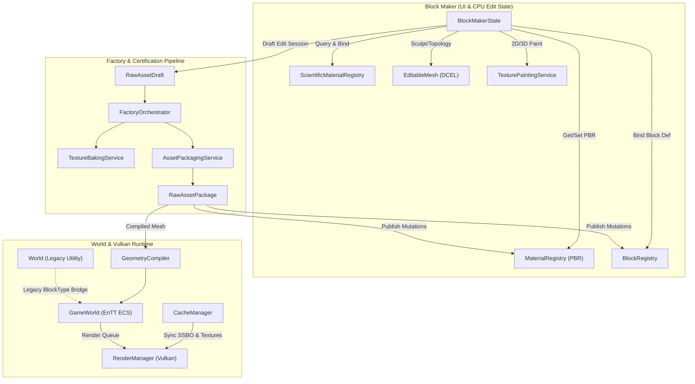
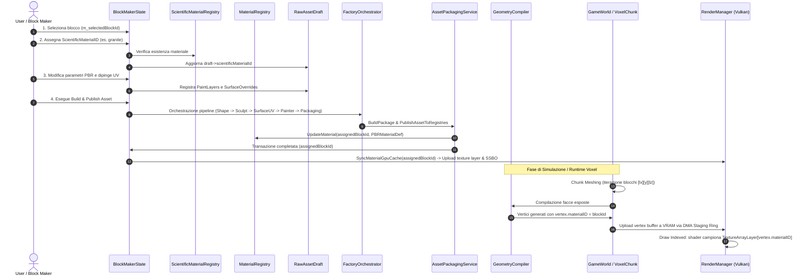
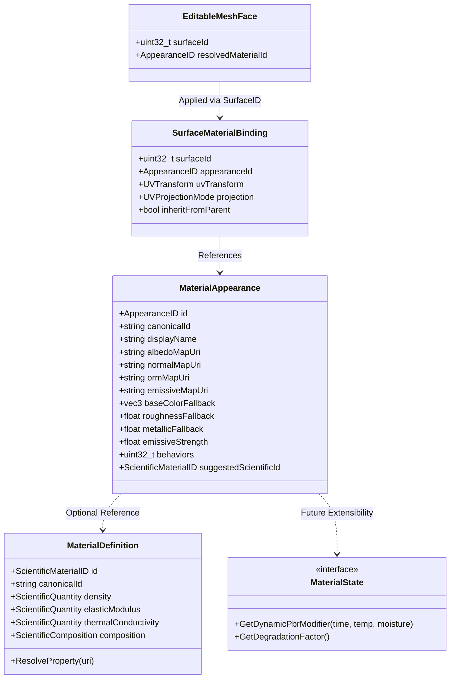
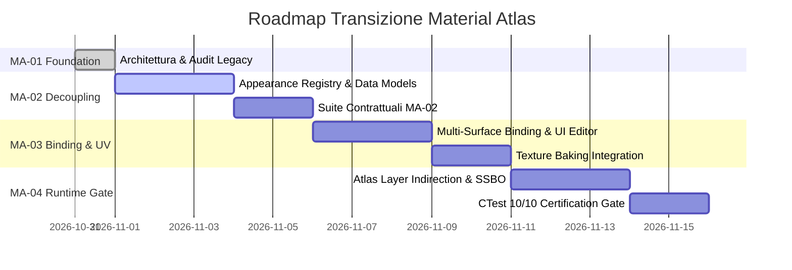

# FAIRWORLD — MA-01: MATERIAL ATLAS FOUNDATION AUDIT
**Document Version:** 1.0.0-FINAL  
**Status:** ARCHITECTURAL AUDIT & PROPOSAL (NO-CODE / FROZEN BASELINE)  
**Target:** Material Atlas Architecture, Pipeline Decomposition, and World Legacy Compatibility  
**Author:** Antigravity AI Engineering Team  
**Date:** 2026-10-31  

---

## Executive Summary

Con il completamento e il congelamento (**FROZEN**) di **MEM-07B** (Build Debug e Release PASS, suite CTest 10/10 verificate), il motore FAIRWORLD entra nella fase **MATERIAL ATLAS**.

L'obiettivo di **MA-01** è condurre una ricognizione rigorosa dell'intera pipeline esistente dei materiali — dall'autoring in Block Maker, attraverso la fabbrica headless e il packaging certificato, fino alla compilazione geometrica e al caricamento nei descrittori Vulkan — ed esaminare l'interazione critica con il sottosistema legacy `World` / `BlockType`.

Sulla base di tale audit, questo documento:
1. Mappa lo stato dell'arte e i limiti tecnologici verificati di ogni componente.
2. Analizza in dettaglio la compatibilità retroattiva con `World` e definisce la **Matrice delle Dipendenze Legacy**.
3. Propone l'architettura minima di **Material Atlas** fondata sulla netta separazione dei 4 concetti cardinali (*MaterialDefinition*, *MaterialAppearance*, *SurfaceMaterialBinding*, *MaterialState*).
4. Traccia la roadmap incrementale di implementazione per le fasi **MA-02**, **MA-03** e **MA-04**, corredata da criteri di accettazione verificabili e vincoli di non-regressione.

> [!IMPORTANT]
> **Vincoli di MA-01 rispettati rigorosamente:** Nessuna modifica a codice sorgente o test, nessuna esecuzione di comandi di build, nessun refactoring del modulo `World`, e nessun avvio prematuro dell'implementazione. Il presente audit è rilasciato per la revisione architetturale esterna.

---

## 1. Inventario dei Sistemi Esistenti e Punti di Integrazione

Di seguito viene censita l'infrastruttura reale attualmente presente nella codebase `d:/FAIRWORLD/FAIRWORLD`.



### 1.1 ScientificMaterialRegistry e Contratti Scientifici
- **File Principali:** [`src/blocks/ScientificMaterialRegistry.h`](file:///d:/FAIRWORLD/FAIRWORLD/src/blocks/ScientificMaterialRegistry.h), [`src/blocks/ScientificMaterialRegistry.cpp`](file:///d:/FAIRWORLD/FAIRWORLD/src/blocks/ScientificMaterialRegistry.cpp)
- **Responsabilità:** Custodire le definizioni dei materiali scientifici fondati sulla fisica e sulla chimica del mondo reale (densità, porosità, modulo elastico, resistenze meccaniche, conducibilità termica, capacità termica, composizioni percentuali, tassonomia ontologica). Caricato in modo immutabile e deterministico da `assets/definitions/scientific_materials.json`.
- **Dati Disponibili:**
  - `ScientificMaterialID` (`uint32_t`, zero = non valido).
  - Identificatore canonico URI (es. `"fairworld:mat/granite"`, `"fairworld:mat/iron"`).
  - Grandezze dimensionali misurate `ScientificQuantity` conformi al Sistema Internazionale (SI), con stato epistemico (`PropertyState::Known / Unknown`), livello di evidenza e citazione delle fonti.
  - Tassonomia ontologica (`ScientificKind`: Element, Compound, Mineral, Rock, Mixture, Alloy, Organic, Composite) e relazioni tassonomiche.
  - Composizione chimica/formulare (`ScientificComposition`) con vincoli di normalizzazione e verifica di cicli.
- **Limiti Verificati:**
  - È un registro **puramente scientifico**. Non possiede attributi visivi (texture, colori, normali, roughness, metallicità).
  - È completamente disaccoppiato dalle mesh e dalle coordinate UV.
  - Non partecipa direttamente all'invio di dati alla GPU Vulkan.

### 1.2 MaterialRegistry e Definizioni PBR
- **File Principali:** [`src/blocks/MaterialRegistry.h`](file:///d:/FAIRWORLD/FAIRWORLD/src/blocks/MaterialRegistry.h), [`src/blocks/MaterialRegistry.cpp`](file:///d:/FAIRWORLD/FAIRWORLD/src/blocks/MaterialRegistry.cpp)
- **Responsabilità:** Archivio storico delle definizioni visive PBR per i blocchi, serializzato in `assets/definitions/materials.json`.
- **Dati Disponibili:**
  - Array interno indicizzato per `uint8_t blockId` (0..255).
  - `PBRMaterialDef`: percorsi texture relativi (`albedoPath`, `normalPath`, `ormPath`), parametri scalari di fallback (`baseColorFallback`, `roughnessFallback`, `metallicFallback`, `emissiveStrength`, `alphaFallback`).
  - Flag comportamentali GPU `BlockBehavior` (`BLOCK_BEHAVIOR_EMISSIVE`, `BLOCK_BEHAVIOR_ANIMATED`, ecc.).
  - Struttura GPU `BlockPropertiesGPU` allineata a 16 byte per l'SSBO Vulkan.
  - Mappatura UV di base (`UVTransform baseUVTransform`, `UVProjectionMode baseProjection`).
  - Vettore di `SurfaceOverride surfaces` per personalizzazione per-faccia.
- **Limiti Verificati:**
  - **Conflazione tra Blocco e Materiale:** Il registro non mappa materiali indipendenti, ma è una tabella indicizzata strettamente da `uint8_t target_block_id`. Non esiste il concetto di "Materiale PBR riutilizzabile da più blocchi differenti".
  - **Inquinamento Geometrico:** `PBRMaterialDef` include `shapeType`, `superSphereN` e `ShapeHandle sharedShape`, mescolando la geometria della forma con l'aspetto ottico del materiale.

### 1.3 BlockRegistry e Collegamenti MaterialID
- **File Principali:** [`src/blocks/BlockRegistry.h`](file:///d:/FAIRWORLD/FAIRWORLD/src/blocks/BlockRegistry.h), [`src/blocks/BlockRegistry.cpp`](file:///d:/FAIRWORLD/FAIRWORLD/src/blocks/BlockRegistry.cpp)
- **Responsabilità:** Registro sovrano degli asset blocco simulabili nel voxel engine. Caricato da `assets/definitions/blocks.json`.
- **Dati Disponibili:**
  - `SimBlockDef`: identificatore numerico `uint8_t id` (1..255), string ID canonico (es. `"fairworld:stone"`), display name.
  - Riferimento scalare `uint32_t scientificMaterialId` verso `ScientificMaterialRegistry`.
  - Override locali di proprietà scientifiche `ScientificPropertyOverrides`.
  - Contratto fisico `BlockPhysicsDef` (massa, densità, frizione, restituzione, motion type, calcolo massa derivata).
  - Trasformazione locale dell'asset (`localPosition`, `localRotation`, `localScale`, `pivotOffset`).
  - Diagnostica cross-registry `ValidateScientificReferences` che verifica l'esistenza dei riferimenti scientifici.
- **Limiti Verificati:**
  - Possiede un solo campo scalare `scientificMaterialId` per l'intero blocco: non supporta materiali scientifici eterogenei su facce diverse dello stesso blocco.
  - Non conosce direttamente le mappe texture né le coordinate UV (delegate a `MaterialRegistry`).

### 1.4 MaterialID, SurfaceID e Attributi per Faccia in Geometria
- **File Principali:** [`src/blocks/sculpt/EditableMesh.h`](file:///d:/FAIRWORLD/FAIRWORLD/src/blocks/sculpt/EditableMesh.h), [`src/blocks/SurfaceDefinition.h`](file:///d:/FAIRWORLD/FAIRWORLD/src/blocks/SurfaceDefinition.h)
- **Responsabilità:** Rappresentazione topologica half-edge (DCEL) CPU-authoritative della geometria poligonale, e catalogazione delle superfici semantiche.
- **Dati Disponibili:**
  - In `MeshFace`:
    - `uint32_t surfaceId`: partizione geometrica semantica (es. per un cubo: 0=Back, 1=Front, 2=Left, 3=Right, 4=Bottom, 5=Top; per un cilindro: 0=Body, 1=TopCap, 2=BottomCap).
    - `uint32_t materialId`: identificatore di materiale assegnato alla specifica faccia poligonale.
    - `glm::vec3 faceNormal`, `float area`.
  - In `MeshHalfEdge`:
    - `CornerAttributes corner`: coordinate `glm::vec2 uv`, normale interpolata `glm::vec3 normal`, colore vertice `glm::vec4 color`.
  - In `SurfaceOverride` (`SurfaceDefinition.h`):
    - `surfaceId`, `materialId`, `useExplicitMaterial`, `UVTransform`, `SurfaceTextureBinding` (mappe per-superficie).
- **Limiti Verificati:**
  - Nel DCEL, `MeshFace::materialId` è presente, ma storicamente l'editor e il compilatore lo collassavano sull'indice del blocco o su un layer locale, a causa dell'assenza di un Material Registry disaccoppiato.

### 1.5 UVLayout, TexturePaintingService e Texture Baked
- **File Principali:** [`src/blocks/uv/UVLayout.h`](file:///d:/FAIRWORLD/FAIRWORLD/src/blocks/uv/UVLayout.h), [`src/blocks/texture/TexturePaintingService.h`](file:///d:/FAIRWORLD/FAIRWORLD/src/blocks/texture/TexturePaintingService.h), [`src/blocks/factory/TextureBakingService.h`](file:///d:/FAIRWORLD/FAIRWORLD/src/blocks/factory/TextureBakingService.h)
- **Responsabilità:** Unwrapping UV, impacchettamento in atlanti 2D (`UVAtlasPacker`), painting multi-layer su CPU (`PaintLayer`, `ImageBitmap`) ed esportazione finale in PNG con garanzie Zero-Work.
- **Dati Disponibili:**
  - Isole UV orientate (`UVPolarIsland`), bounding box nell'atlante (`[0, 1]`), maschere raster di clipping isola (`UVIslandRasterMask`).
  - Texture painting headless su stack di layer RGBA (`PaintLayer` con blend mode, opacità e dirty rect).
  - Esportazione atomica deterministica via `TextureBakingService`: computazione hash FNV-1a dei pixel, compressione PNG e salvataggio solo in caso di contenuto variato (`wasCacheHitNoEncoding`, `wasCacheHitNoDiskWrite`).
- **Limiti Verificati:**
  - Il baking attuale esporta primariamente una singola mappa combinata per asset (`albedoMapUri`), limitando la possibilità di condividere texture atlas globali tra blocchi differenti.

### 1.6 FactoryOrchestrator, AssetPackage, Serializzazione e Pubblicazione
- **File Principali:** [`src/blocks/factory/RawAssetContract.h`](file:///d:/FAIRWORLD/FAIRWORLD/src/blocks/factory/RawAssetContract.h), [`src/blocks/factory/FactoryOrchestrator.h`](file:///d:/FAIRWORLD/FAIRWORLD/src/blocks/factory/FactoryOrchestrator.h), [`src/blocks/factory/AssetPackagingService.h`](file:///d:/FAIRWORLD/FAIRWORLD/src/blocks/factory/AssetPackagingService.h)
- **Responsabilità:** Pipeline a 9 stazioni che converte un `RawAssetDraft` in un `RawAssetPackage` compilato, immutabile, firmato con SHA-256 e pubblicabile tramite transazioni ACID su disco e nei registri.
- **Dati Disponibili:**
  - `RawAssetDraft`: sorgente geometrica (`GeometrySource::Primitive` o `SculptedMesh`), superfici semantiche, layer di pittura, parametri PBR, proprietà fisiche.
  - `RawAssetPackage`: geometria compilata (`CompiledGeometry`: vertici, facce triangolari), binding compilati `CompiledMaterialBinding` (`surfaceId`, `materialLayer`, `pbrParams`), impronta crittografica `contentDigestSha256`, topologia serializzata `sculptTopologyJson`.
  - Pubblicazione transazionale con journal e crash recovery (`AssetPackagingService::PublishAssetToRegistries`).
- **Limiti Verificati:**
  - Durante il commit nei registri a runtime, `AssetPackagingService` aggiorna `BlockRegistry` e `MaterialRegistry` usando `targetRuntimeVoxelId` (`uint8_t`), reimmettendo l'asset compilato nel collo di bottiglia a 256 slot globali.

### 1.7 Block Maker UI e Interfaccia Materiali
- **File Principali:** [`src/states/BlockMakerState.h`](file:///d:/FAIRWORLD/FAIRWORLD/src/states/BlockMakerState.h), [`src/states/BlockMakerState.cpp`](file:///d:/FAIRWORLD/FAIRWORLD/src/states/BlockMakerState.cpp)
- **Responsabilità:** Ambiente di authoring per l'utente/designer.
- **Dati Disponibili:**
  - `DrawScientificMaterialUI`: selezione da menu a tendina dell'ID scientifico da `ScientificMaterialRegistry`, visualizzazione di formula chimica, classificazione e proprietà SI.
  - `DrawDiagnosticsControls`: editing dei canali PBR fallback (roughness, metallic, emissive, albedo color).
  - Editing delle superfici (`SurfaceOverride`) con impostazione di texture individuali o mapping UV.
  - Sincronizzazione immediata della preview GPU tramite `CacheManager::SyncMaterialGpuCache(m_selectedBlockId, m_context)`.
- **Limiti Verificati:**
  - L'UI costringe l'utente a editare il materiale del blocco selezionato (`m_selectedBlockId`), impedendo di creare o sfogliare una libreria separata di materiali visivi ("Palette Materiali") da applicare drag-and-drop a singole facce.

### 1.8 Percorso Runtime e Rendering Vulkan
- **File Principali:** [`src/world/GameWorld.cpp`](file:///d:/FAIRWORLD/FAIRWORLD/src/world/GameWorld.cpp), [`src/world/GeometryCompiler.cpp`](file:///d:/FAIRWORLD/FAIRWORLD/src/world/GeometryCompiler.cpp), [`src/render/RenderManager.cpp`](file:///d:/FAIRWORLD/FAIRWORLD/src/render/RenderManager.cpp), [`src/core/memory/CacheManager.cpp`](file:///d:/FAIRWORLD/FAIRWORLD/src/core/memory/CacheManager.cpp)
- **Responsabilità:** Compilazione della geometria in vertex buffer e trasmissione alle pipeline shader Vulkan.
- **Dati Disponibili:**
  - Struttura del vertice ABI Vulkan (64 byte esatti):
    ```cpp
    struct Vertex {
        glm::vec3 pos;        // 12 bytes
        glm::vec4 color;      // 16 bytes
        glm::vec2 roughMetal; //  8 bytes (reinterpretato come coordinate UV negli shader texturizzati)
        uint32_t materialID;  //  4 bytes (indice di layer nella 2D Texture Array)
        glm::vec3 normal;     // 12 bytes
        float ao;             //  4 bytes
        float light;          //  4 bytes
        float emissive;       //  4 bytes
    }; // Totale: 64 byte
    ```
  - Nel backend Vulkan (`RenderManager`):
    - Binding 0: `VkImage` 2D Texture Array Albedo (256 layer).
    - Binding 1: `VkImage` 2D Texture Array Normal (256 layer).
    - Binding 2: `VkImage` 2D Texture Array ORM (256 layer).
    - Binding 3: `VkBuffer` SSBO `BlockPropertiesGPU` (256 elementi con proprietà PBR e behavior).
- **Limiti Verificati:**
  - Il rendering di chunk e blocchi standard è interamente architettato attorno al presupposto che `materialID == blockId` (con un massimo di 256 materiali attivi contemporaneamente nel Texture Array globale).

---

## 2. Flusso Attuale del Materiale dall'Editor al Runtime



### Criticità Emerse nel Flusso Attuale
1. **Accoppiamento 1:1 tra Blocco e Materiale Visivo:** Il layer GPU `vertex.materialID` corrisponde al `blockId`. Non è possibile assegnare a facce differenti dello stesso blocco voxel due texture layer distinti, a meno di non emettere blocchi multi-layer non supportati dal chunk voxel mesher.
2. **Perdita dei Metadati Scientifici:** Sebbene `ScientificMaterialRegistry` contenga centinaia di parametri fisici accurati, nel runtime `GameWorld` tali parametri non vengono mai trasferiti al chunk mesher o alla simulazione voxel: `GameWorld` si limita a interrogare `BlockType` o la tabella statica legacy `BlockMaterial.h`.

---

## 3. World / BlockType Legacy Compatibility

Come richiesto espressamente dall'addendum di missione, viene qui analizzata la compatibilità con i moduli storici `src/core/utils/World.h`, `src/core/utils/World.cpp` e la duplicazione di `BlockType`.

### 3.1 Dove `BlockType` è ancora utilizzato e quale funzione svolge
Dalla scansione globale della codebase, `BlockType` compare in 3 declinazioni:
1. **`src/core/utils/World.h`:** Enum `enum class BlockType : uint8_t` (valori 0..16, da `Air` a `Obsidian`). Governa la griglia voxel legacy del prototipo (`uint8_t blocks[16][128][16]`), il calcolo dei colori piatti tramite `BlockColor()`, la propagazione dei fluidi e la termodinamica empirica.
2. **`src/components/ForgeComponents.h`:** Enum `enum class BlockType : uint8_t` (valori 0..16, più `OutOfBounds = 255`). Utilizzato da `VoxelChunkComponent` e dal moderno `GameWorld`.
3. **`src/systems/PhysicsEngine.cpp` e `RaycastSystem.cpp`:** Utilizzato per i test di collisione solida/liquida (`feetBlock == BlockType::Water`, `b != BlockType::Air`, `b == BlockType::OutOfBounds`).

### 3.2 Conversioni Esistenti tra Registri
Non esistono funzioni di conversione formali, sicure o biiettive:
- La conversione avviene quasi ovunque tramite **cast brutale reinterpretativo**: `(uint8_t)type`, assumendo che l'ID del blocco coincida con il valore ordinale dell'enum.
- Non esiste alcun legame strutturato tra `BlockType::Stone` (valore 3) e `ScientificMaterialRegistry` (dove ad esempio la pietra potrebbe essere `"fairworld:mat/granite"` con `ScientificMaterialID = 1`, o basalto con ID 12).
- Non esiste legame tra `BlockType` e `MaterialRegistry`, se non per il fatto che all'avvio del motore le prime 17 posizioni di `MaterialRegistry` vengono popolate con parametri di default compatibili con i 17 `BlockType` storici.

### 3.3 Analisi della Perdita Dati (Editor -> World Runtime)
1. **Perdita Dati Scientifici:** Quando un utente modula densità, frizione, punto di fusione o modulo di Young in Block Maker, questi dati vengono serializzati in `blocks.json` (`SimBlockDef::physics` e `scientificOverrides`). Tuttavia, `World.cpp` e `GameWorld.cpp` non leggono queste proprietà: utilizzano invece la tabella fissa `BlockMaterial.h` (che contiene costanti statiche hardcoded per i 17 tipi primordiali) oppure valori hardcoded nel tick termodinamico (`heatCapacity = 100000.0`).
2. **Perdita Dati Visivi e UV:** Se un blocco creato in Block Maker definisce superfici complesse (es. la faccia Top con UV rotata a 90° e texture differente), il chunk mesher di `World.cpp` e `GameWorld.cpp` genera un cubo con coordinate fisse `UVS[4]` e imposta `materialID = blockId`. Tutta la ricchezza poligonale delle superfici semantiche viene azzerata a favore di un box uniforme.

### 3.4 Responsabilità Indebite di `src/core/utils/World`
Il file `src/core/utils/World` rappresenta un residuo "God Object" di architettura monolitica:
- **Generazione procedurale:** Implementa algoritmi di generazione (`GenerateChunk`, `CarveRiver`, `PlaceTree`) che competono con il moderno `TerrainSolver`.
- **Rappresentazione ottica:** Implementa `BlockColor(BlockType)` con valori RGB cablati nel codice C++.
- **Fisica e Chimica:** Implementa la simulazione dei fluidi e il riscaldamento/raffreddamento in modo accoppiato alla griglia dei puntatori dei chunk.
- **Astronomia:** Mantiene la simulazione orbitale planetaria (`m_solarSystem`, `SimulateOrbits`), estranea al concetto di mondo voxel.

### 3.5 Parti Legacy da Mantenere Temporaneamente
Per garantire la stabilità di build e l'esecuzione impeccabile delle suite CTest attuali (incluso `FairworldPhysicsTests` e i test di lifecycle), è tassativo mantenere intatte:
1. Le firme di `BlockType` e i valori 0..16 per l'interazione con `PhysicsEngine` e `RaycastSystem`.
2. La firma a 64 byte di `struct Vertex` in `src/core/utils/World.h` e `src/render/RenderManager.h`.
3. Le query `GetBlockCartesian` e `GetBlockFlat` in `GameWorld`.

### 3.6 Matrice delle Dipendenze Legacy

| File Sorgente | Simboli Coinvolti | Livello di Rischio per Material Atlas | Impatto Architetturale | Strategia Proposta |
| :--- | :--- | :--- | :--- | :--- |
| `src/core/utils/World.h` / `.cpp` | `enum class BlockType`, `BlockColor()`, `AddFace()` | **ALTO** | Hardcoding dei colori e collasso di `materialID` sul tipo di blocco. | **Isolamento Completo:** Non toccare il file in MA. World.h resta relegato al sottosistema legacy; Material Atlas non ne dipenderà mai. |
| `src/core/entities/BlockMaterial.h` | `struct BlockMaterial`, `GetBlockMaterial(BlockType)` | **MEDIO** | Tabella fisica hardcoded separata da `ScientificMaterialRegistry`. | **Ponte di Fallback (Bridge):** Mantenere per le sole entità che interrogano `BlockType`, ma indirizzare le nuove pipeline verso `BlockPhysicsDef`. |
| `src/components/ForgeComponents.h` | `BlockType`, `VoxelChunkComponent::blocks` | **ALTO** | Voxel memorizzati come `uint8_t` (0..255). | **Conservazione ABI:** Mantenere `blocks[16][128][16]` come `uint8_t` (ID del blocco). Il mapping a materiale avverrà tramite indirezione di registro, non mutando la griglia voxel. |
| `src/systems/PhysicsEngine.cpp` | `GetBlock()`, check su `Water`, `Air`, `Lava` | **BASSO** | Controlli semantici di movimento e galleggiamento. | **Preservare as-is:** Non costituisce blocco per Material Atlas in quanto attiene unicamente al movimento del player/rigidbody. |
| `src/world/GameWorld.cpp` | `chunk.blocks[x][y][z]`, chunk meshing `materialID = block` | **CRITICO** | Assegnazione forzata del material layer GPU uguale all'ID del blocco. | **Risoluzione Indiretta (MA-03/MA-04):** Introdurre una tabella di lookup `BlockToMaterialAtlasMapping` che risolva il materiale associato prima di popolare `vertex.materialID`. |
| `src/render/RenderManager.cpp` | `UpdateBlockPropertiesSSBO`, Texture Array a 256 layer | **CRITICO** | Limite fisico hardware di 256 layer nel descriptor set. | **Gestione Atlas Layer (MA-04):** Mantenere l'array a 256 layer, ma assegnare i layer GPU a `MaterialAppearanceID` anziché rigidamente a `blockId`. |

---

## 4. Lacune Concrete Rispetto all'Obiettivo Material Atlas

Dall'analisi emergono quattro lacune architetturali primarie che impediscono oggi l'adozione fluida di Material Atlas:

1. **Assenza di un `MaterialAppearanceRegistry` Disaccoppiato:**  
   Oggi i parametri visivi risiedono dentro `PBRMaterialDef` in `MaterialRegistry`, ma sono accessibili e modificabili unicamente specificando un `uint8_t blockId`. Non è possibile definire un materiale "Rame Ossidato" se non associandolo a uno slot blocco esistente tra 1 e 255.
2. **Impossibilità di Condivisione Materiali Visivi:**  
   Se cinque blocchi differenti (es. Muro di Pietra, Scala di Pietra, Lastra di Pietra, Colonna di Pietra, Mattone di Pietra) utilizzano la stessa identica texture e parametri PBR, attualmente il motore duplica il materiale in cinque slot separati del Texture Array GPU, sprecando VRAM e canali di campionamento.
3. **Mancanza di Indipendenza tra `SurfaceID` e `MaterialID`:**  
   In `BlockMakerState`, la selezione di una superficie (`SurfaceOverride`) consente di specificare `materialId`, ma tale valore non ha un catalogo globale autorevole a cui fare riferimento; viene spesso ignorato dal compilatore geometrico o interpretato come indice di layer locale provvisorio.
4. **Disallineamento Scientifico-Visivo:**  
   Non esiste una relazione formale che suggerisca a `MaterialAppearance` quali proprietà fisiche adottare sulla base del `ScientificMaterialID` assegnato (es. se associo il materiale scientifico "Oro", l'aspetto visivo non riceve automaticamente la raccomandazione di impostare metallicità = 1.0 e albedo giallo dorato).

---

## 5. Architettura Minima Proposta: I 4 Cardini

Per colmare tali lacune senza introdurre nuovo debito tecnico e rispettando i vincoli di Zero-Work e determinismo, l'architettura di **Material Atlas** viene strutturata attorno a 4 concetti indipendenti e complementari:



### A. MaterialDefinition — Identità e Proprietà Scientifiche
- **Sorgente Autorevole:** Coincide con `ScientificMaterialRegistry`.
- **Identificatore:** `ScientificMaterialID` (`uint32_t`) e URI canonico (`"fairworld:mat/..."`).
- **Natura:** Rigorosamente scientifica, puramente deterministica, priva di nozioni di rendering, texture, UV o GPU.
- **Ruolo:** Fornisce la verità fisica su densità, massa derivata, comportamento termico e meccanico.

### B. MaterialAppearance — Rappresentazione Visiva e Parametri PBR
- **Nuovo Record / Evoluzione di `PBRMaterialDef`:** Un'entità visiva autonoma identificata da un proprio `AppearanceID` (`uint32_t`) e URI canonico (es. `"fairworld:appearance/smooth_granite"`).
- **Dati:**
  - Percorsi texture normalizzati (`albedoMapUri`, `normalMapUri`, `ormMapUri`, `emissiveMapUri`).
  - Parametri scalari fallback (`baseColorFallback`, `roughnessFallback`, `metallicFallback`, `emissiveStrength`, `alphaFallback`).
  - Comportamenti shader GPU (`uint32_t behaviors`).
  - Riferimento consigliato a una `ScientificMaterialID` (per validazione e coerenza scientifico-visiva).
- **Vantaggio Fondamentale:** Molti blocchi o molte superfici possono condividere lo stesso `AppearanceID`. Un singolo slot GPU nel Texture Array serve molteplici asset.

### C. SurfaceMaterialBinding — Assegnazione del Materiale alle Superfici
- **Natura:** Il legame esplicito tra la geometria dell'asset e il suo aspetto.
- **Campi:**
  - `uint32_t surfaceId`: identificatore semantico della faccia/superficie geometrica (definito dalla forma o dalla mesh).
  - `AppearanceID appearanceId`: l'aspetto visivo PBR assegnato a quella specifica superficie.
  - `UVTransform uvTransform`: traslazione, rotazione, tiling e mirror locali all'isola della superficie.
  - `UVProjectionMode projection`: planar, box, triplanar, cylindrical, spherical.
- **Preservazione dell'Indipendenza:**
  - `SurfaceID` = partizione puramente geometrica/topologica della mesh.
  - `AppearanceID` = materiale visivo applicato.
  - `ScientificMaterialID` = sostanza fisica costituente.
  - Questa triplice distinzione garantisce che la geometria possa essere deformata senza mutare il materiale, e che il materiale visivo possa cambiare senza alterare le proprietà scientifiche o la topologia UV.

### D. MaterialState — Condizioni Variabili nel Tempo (Interfaccia Futura)
- **Definizione:** Interfaccia astratta puramente dichiarativa per future evoluzioni ambientali (senza implementazione in questa fase, come da vincoli).
- **Interfaccia Astratta Prevista:**
  ```cpp
  class IMaterialStateProvider {
  public:
      virtual ~IMaterialStateProvider() = default;
      virtual glm::vec4 EvaluatePbrModulation(uint32_t appearanceId, float temperatureK, float moisture) const = 0;
      virtual float EvaluateWeatheringProgress(uint32_t appearanceId, float exposureTime) const = 0;
  };
  ```
- **Conformità ai Vincoli:** Nessuna logica attiva in MA-01..MA-04. Non introduce carichi computazionali né rompe il determinismo attuale.

---

## 6. Piano Incrementale di Implementazione (MA-02, MA-03, MA-04)



### 6.1 Fase MA-02 — Disaccoppiamento Registri e Definizione MaterialAppearance
- **Obiettivo:** Creare il catalogo autonomo `MaterialAppearanceRegistry` (o estendere in sicurezza `MaterialRegistry` rimuovendo il legame vincolante con `blockId`).
- **Azioni:**
  1. Definire la struttura immutabile `MaterialAppearance` con proprio schema JSON (`assets/definitions/appearances.json`).
  2. Implementare la validazione deterministica cross-reference con `ScientificMaterialRegistry`.
  3. Mantenere uno shim di compatibilità per il vecchio codice che chiama `GetMaterial((uint8_t)blockId)`.
- **Criteri di Accettazione e Test:**
  - Nuova suite contrattuale `MaterialAppearanceContractTests` (10 test nominali): round-trip JSON, rilevamento duplicati, validazione URI, fallback PBR.
  - Nessuna regressione sulle 10 suite CTest esistenti (tutti i 286 test UV e i test di memoria rimangono PASS).

### 6.2 Fase MA-03 — Multi-Surface Binding e Integrazione Pittura UV
- **Obiettivo:** Consentire a Block Maker e alla pipeline di fabbrica di assegnare `AppearanceID` differenti a superfici semantiche diverse (`SurfaceOverride`), preservando l'isolamento della pittura 2D/3D.
- **Azioni:**
  1. Aggiornare `SurfaceOverride` e `MeshFace` per referenziare formalmente `AppearanceID`.
  2. Aggiornare `TexturePaintingService` e `TextureBakingService` affinché il baking per-superficie produca compositing corretti senza bleeding tra isole UV adiacenti con materiali diversi.
  3. Arricchire l'interfaccia utente di `BlockMakerState` con il pannello "Material Palette" per l'assegnazione drag-and-drop del materiale visivo alla superficie selezionata.
- **Criteri di Accettazione e Test:**
  - Test contrattuale di isolamento superfici (`UV-4` esteso a multi-materiale).
  - Verifica Zero-Work su modifiche di superficie: la modifica di una sola superficie non invalida le isole UV delle superfici invariate.

### 6.3 Fase MA-04 — Compilazione Asset e Runtime Material Atlas Gate
- **Obiettivo:** Portare i binding compilati nel pacchetto `RawAssetPackage` e garantire la resa a runtime senza superare i limiti dell'array Vulkan a 256 layer.
- **Azioni:**
  1. Compilare `CompiledMaterialBinding` dentro `RawAssetPackage`.
  2. Aggiornare `AssetPackagingService` per registrare sia il blocco sia le sue appearance collegate.
  3. Nel voxel mesher di `GameWorld`, risolvere l'indice di materiale della faccia consultando la tabella dei binding dell'asset.
- **Criteri di Accettazione e Test:**
  - Pipeline e-2-e completa: authoring in Block Maker -> packaging atomico SHA-256 -> caricamento in `GameWorld` -> rendering del blocco texturizzato in Vulkan.
  - Gate di chiusura con audit di certificazione 10/10 CTest PASS in entrambe le configurazioni Debug e Release.

---

## 7. Rischi di Regressione e Strategia di Compatibilità

### 7.1 Retrocompatibilità degli Asset Esistenti (Schema V1 e V2)
- Gli asset già confezionati non contengono `AppearanceID`, ma contengono parametri PBR fallback dentro `SimBlockDef` o `materials.json`.
- **Strategia:** Meccanismo di migrazione automatica on-the-fly (`AssetSchemaMigrationService`): se un asset caricato è sprovvisto di binding di appearance, viene generata un'appearance sintetica con naming `"fairworld:appearance/auto_block_<ID>"` mappata 1:1 sui parametri legacy. Nessun file esistente verrà corrotto o reso illeggibile.

### 7.2 Conservazione dei Meccanismi Zero-Work e Determinismo
- Qualsiasi introduzione di nuovi identificatori o indici deve preservare gli hash FNV-1a a 64 bit e le impronte SHA-256 certificate in MEM-07B.
- Se l'aspetto visivo di una superficie non subisce variazioni, la revisione `appearanceRevision` rimane inalterata, prevenendo ricompilazioni geometriche della mesh o ri-baking di file PNG su disco.

### 7.3 Isolamento Rigoroso da `World` Legacy
- I file `src/core/utils/World.h` e `World.cpp` **non vengono toccati**.
- Eventuali conversioni da/verso `BlockType` vengono incapsulate in funzioni bridge isolate (es. `MaterialAtlasLegacyBridge::ResolveLegacyBlockType()`), impedendo che il codice storico inquini la nuova architettura di Material Atlas.

---

## 8. Conclusioni e Raccomandazioni

L'audit MA-01 conferma che:
1. Il motore FAIRWORLD possiede già fondamenta eccellenti per la fisica dei materiali (`ScientificMaterialRegistry`), per la manipolazione geometrica (`EditableMesh`), per la pittura (`TexturePaintingService`) e per il packaging durevole (`AssetPackagingService`).
2. Il collo di bottiglia principale risiede nell'accoppiamento storico 1:1 tra Blocco (`uint8_t`) e Materiale Visivo PBR, e nella commistione con l'enum legacy `BlockType`.
3. L'architettura proposta a 4 cardini (**MaterialDefinition**, **MaterialAppearance**, **SurfaceMaterialBinding**, **MaterialState**) risolve questo disallineamento in modo minimale, pulito e modulare, senza rifare da zero il renderer Vulkan e senza toccare il monolite `World`.

**Stato dell'Azione:**  
L'audit `FAIRWORLD_MATERIAL_ATLAS_MA01_AUDIT.md` è completo, autonomo e pronto per la revisione architetturale esterna da parte di ChatGPT. Si attende validazione prima di procedere con la pianificazione esecutiva di MA-02.
