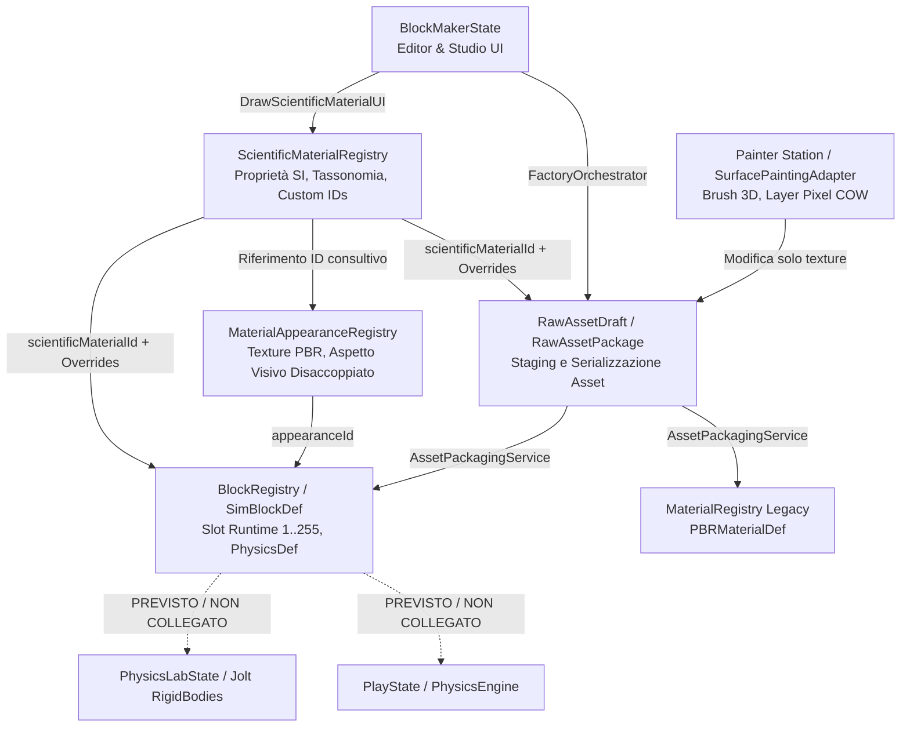

# FAIRWORLD — P0.3A: SCIENTIFIC MATERIAL INTEGRATION AUDIT & MAPPING

> **Stato:** AUDIT & INTEGRATION MAPPING COMPLETO (NESSUNA MODIFICA AL CODICE ESEGUITA)  
> **Data:** Novembre 2026  
> **Ambito:** Integrazione del catalogo scientifico (`ScientificMaterialRegistry`) e dell'aspetto visivo (`MaterialAppearanceRegistry`) nel workflow reale di Block Maker, Factory, Asset Packaging, PhysicsLab e PlayState.  
> **Invarianti FROZEN:** P0.2A, P0.2B, P0.2C e P0.2D rimangono intatti e congelati (CUST 27/27 PASS, CTest 12/12 PASS).

---

## 1. MAPPA DEI SISTEMI ESISTENTI

La ricognizione del codebase ha identificato sette sottosistemi cardine coinvolti nel ciclo di vita dei materiali, della geometria, delle proprietà fisiche e della serializzazione degli asset.

---

### 1.1 ScientificMaterialRegistry
- **File e Classi:**  
  - Header: [`src/blocks/ScientificMaterialRegistry.h`](file:///d:/FAIRWORLD/FAIRWORLD/src/blocks/ScientificMaterialRegistry.h)  
  - Sorgente: [`src/blocks/ScientificMaterialRegistry.cpp`](file:///d:/FAIRWORLD/FAIRWORLD/src/blocks/ScientificMaterialRegistry.cpp)  
  - Tipi: [`src/blocks/ScientificMaterialTypes.h`](file:///d:/FAIRWORLD/FAIRWORLD/src/blocks/ScientificMaterialTypes.h)
- **Responsabilità Attuali:**
  - Fonte autoritativa esclusiva per la definizione delle proprietà termodinamiche, meccaniche e fisiche basate su standard SI (12 proprietà canoniche: `Density`, `Porosity`, `CompressiveStrength`, `TensileStrength`, `ElasticModulus`, `StaticFriction`, `DynamicFriction`, `Restitution`, `SpecificHeatCapacity`, `ThermalConductivity`, `ThermalExpansion`, `MeltingPoint`).
  - Gestione della tassonomia dei materiali (`MaterialTaxonomy`: Kingdom, Class, Family) e stati di aggregazione (`AggregationState`).
  - Gestione thread-safe con lettura non bloccante lock-free tramite snapshot immutabili (`RegistrySnapshot`, `SnapshotHandle`, validati in P0.2A/P0.2B).
  - Persistenza durevole e sicura dei materiali custom (`ReserveDurableCustomMaterialId`, `SaveCustomMaterialsToJson` protetto da Lost Update e atomic replace Win32, validati in P0.2C/P0.2D).
- **API Pubbliche Riutilizzabili:**
  - `bool HasMaterial(uint32_t id) const` (`ScientificMaterialRegistry.h:176`)
  - `const ScientificMaterialDef& GetMaterial(uint32_t id) const` (`ScientificMaterialRegistry.h:177`)
  - `const ScientificMaterialDef& GetMaterialByCanonicalId(const std::string& id) const` (`ScientificMaterialRegistry.h:178`)
  - `SnapshotHandle GetSnapshotHandle() const` (`ScientificMaterialRegistry.h:182`)
  - `ScientificQuantity ResolveProperty(uint32_t id, const std::string& prop, const ScientificPropertyOverrides& overrides) const` (`ScientificMaterialRegistry.h:185`)
  - `uint32_t ReserveDurableCustomMaterialId(const std::string& filepath)` (`ScientificMaterialRegistry.h:199`)
  - `bool SaveCustomMaterialsToJson(const std::string& filepath, uint64_t expectedRevision, bool forceOverwrite)` (`ScientificMaterialRegistry.h:203`)
- **Collegamenti Già Presenti:**
  - `SimBlockDef` memorizza `uint32_t scientificMaterialId` e `ScientificPropertyOverrides scientificOverrides` ([`src/blocks/BlockRegistry.h:53-54`](file:///d:/FAIRWORLD/FAIRWORLD/src/blocks/BlockRegistry.h#L53-L54)).
  - `BlockRegistry::ValidateScientificReferences(...)` esegue audit diagnostico read-only contro il registro ([`src/blocks/BlockRegistry.h:145`](file:///d:/FAIRWORLD/FAIRWORLD/src/blocks/BlockRegistry.h#L145)).
  - `RawAssetDraft` e `RawAssetPackage` contengono `scientificMaterialId` e `scientificOverrides` ([`src/blocks/factory/RawAssetContract.h:298-299`](file:///d:/FAIRWORLD/FAIRWORLD/src/blocks/factory/RawAssetContract.h#L298-L299), [`402-403`](file:///d:/FAIRWORLD/FAIRWORLD/src/blocks/factory/RawAssetContract.h#L402-L403)).
  - `BlockMakerState::DrawScientificMaterialUI` visualizza e permette la selezione di materiali dal registro con override live ([`src/states/BlockMakerState.cpp:6674-6850`](file:///d:/FAIRWORLD/FAIRWORLD/src/states/BlockMakerState.cpp#L6674-L6850)).
- **Collegamenti Mancanti:**
  - Nessun collegamento con le superfici/parti dell'asset (assente in `SurfaceOverride` e `EditableMesh::MeshFace`).
  - Nessun calcolo o sincronizzazione bidirezionale con `BlockPhysicsDef` (es. `density` e `friction` in `BlockPhysicsDef` sono duplicati e non calcolati automaticamente da `ResolveProperty`).
  - Nessun collegamento runtime con Jolt Physics o ECS (`PhysicsLabState` e `PlayState` non lo interrogano).
- **Duplicazioni / Conflitti:**
  - `BlockPhysicsDef` duplica `density`, `friction` e `restitution` come float isolati, consentendo disallineamenti silenti tra la fisica dell'asset e il materiale scientifico assegnato.

---

### 1.2 MaterialAppearanceRegistry
- **File e Classi:**  
  - Header: [`src/blocks/MaterialAppearanceRegistry.h`](file:///d:/FAIRWORLD/FAIRWORLD/src/blocks/MaterialAppearanceRegistry.h), [`src/blocks/MaterialAppearance.h`](file:///d:/FAIRWORLD/FAIRWORLD/src/blocks/MaterialAppearance.h)  
  - Sorgente: [`src/blocks/MaterialAppearanceRegistry.cpp`](file:///d:/FAIRWORLD/FAIRWORLD/src/blocks/MaterialAppearanceRegistry.cpp)
- **Responsabilità Attuali:**
  - Catalogo CPU autonomo introdotto in MA-02A per separare l'identità visiva PBR (albedo, normal, ORM, emissive, fallback PBR, behavior bitmask) dall'identità del blocco o del materiale scientifico.
  - Risoluzione retrocompatibile per blocchi legacy (`ResolveAppearanceId`, `BootstrapLegacyBlockAppearances`).
  - Campo consultivo `suggestedScientificMaterialId` su `MaterialAppearance` ([`src/blocks/MaterialAppearance.h:47`](file:///d:/FAIRWORLD/FAIRWORLD/src/blocks/MaterialAppearance.h#L47)).
- **API Pubbliche Riutilizzabili:**
  - `bool RegisterAppearance(const MaterialAppearance& def, bool allowUpdate, std::string* outError)` (`MaterialAppearanceRegistry.h:51`)
  - `const MaterialAppearance& GetAppearance(AppearanceID id) const` (`MaterialAppearanceRegistry.h:55`)
  - `AppearanceID ResolveAppearanceId(uint8_t blockId, AppearanceID explicitAppearanceId = 0) const` (`MaterialAppearanceRegistry.h:94`)
  - `const MaterialAppearance& ResolveBlockAppearance(uint8_t blockId, AppearanceID explicitAppearanceId = 0) const` (`MaterialAppearanceRegistry.h:97`)
  - `AppearanceValidationReport ValidateScientificReferences(const ScientificMaterialRegistry& sciRegistry) const` (`MaterialAppearanceRegistry.h:83`)
- **Collegamenti Già Presenti:**
  - Disponibile nel service locator `SharedContext::appearanceRegistry` ([`src/core/app/SharedContext.h:71`](file:///d:/FAIRWORLD/FAIRWORLD/src/core/app/SharedContext.h#L71)).
  - Consultabile e testabile in `MaterialAtlasState` ([`src/states/MaterialAtlasState.cpp:959`](file:///d:/FAIRWORLD/FAIRWORLD/src/states/MaterialAtlasState.cpp#L959)).
  - Riferito da `SimBlockDef::appearanceId` ([`src/blocks/BlockRegistry.h:55`](file:///d:/FAIRWORLD/FAIRWORLD/src/blocks/BlockRegistry.h#L55)) e `PBRMaterialDef::appearanceId` ([`src/blocks/MaterialRegistry.h:31`](file:///d:/FAIRWORLD/FAIRWORLD/src/blocks/MaterialRegistry.h#L31)).
- **Collegamenti Mancanti:**
  - Non integrato nel workflow di `BlockMakerState`: l'Inspector di BlockMaker manipola ancora direttamente percorsi stringa raw (`albedoPath`, `roughnessFallback`) su `PBRMaterialDef` o `RawAssetDraft`, invece di selezionare un `AppearanceID` dal registro.
  - `AssetPackagingService::PublishPackageTransactional` non assegna né serializza `AppearanceID` verso `MaterialAppearanceRegistry`.
- **Duplicazioni / Conflitti:**
  - Coesistenza tra il legacy `MaterialRegistry` (array indicizzato da `uint8_t target_block_id`, che unisce proprietà geometriche e texture) e `MaterialAppearanceRegistry` (catalogo disaccoppiato basato su `AppearanceID uint32_t`).

---

### 1.3 BlockRegistry & SimBlockDef
- **File e Classi:**  
  - Header: [`src/blocks/BlockRegistry.h`](file:///d:/FAIRWORLD/FAIRWORLD/src/blocks/BlockRegistry.h)  
  - Sorgente: [`src/blocks/BlockRegistry.cpp`](file:///d:/FAIRWORLD/FAIRWORLD/src/blocks/BlockRegistry.cpp)
- **Responsabilità Attuali:**
  - Registro centrale di simulazione per i blocchi voxel runtime (tabella a dimensione fissa fino a 256 blocchi, `uint8_t id = 1..255`).
  - `SimBlockDef` contiene:
    - Identità stringa canonica (`fairworld:custom_brick`) e nome leggibile.
    - `scientificMaterialId` e `scientificOverrides`.
    - `appearanceId`.
    - `BlockPhysicsDef physics` (massa, densità, attrito, restituzione, collisionEnabled, motionType, massMode: Manual vs DensityDerived).
    - Campi mirror di backward compatibility (`isSolid`, `mass`, `friction`, `bounciness`).
    - Proprietà termiche grezze (`thermal_resistance`, `thermal_capacity`).
    - Trasformazioni e pivot locali all'asset (`localPosition`, `localRotation`, `localScale`, `pivotOffset`).
- **API Pubbliche Riutilizzabili:**
  - `const SimBlockDef& GetBlock(uint8_t id) const` (`BlockRegistry.h:178`)
  - `SimBlockDef& GetBlockMutable(uint8_t id)` (`BlockRegistry.h:182`)
  - `uint8_t GetBlockIdByString(const std::string& stringId) const` (`BlockRegistry.h:180`)
  - `AssetOpResult CreateBlock(...)`, `DuplicateBlock(...)`, `RenameBlock(...)`, `DeleteBlock(...)` (`BlockRegistry.h:161-170`)
  - `BlockRegistryValidationReport ValidateScientificReferences(const ScientificMaterialRegistry& sciRegistry, ...)` (`BlockRegistry.h:145`)
- **Collegamenti Già Presenti:**
  - Integrato in `SharedContext::blockRegistry`.
  - Aggiornato transazionalmente da `AssetPackagingService::PublishPackageTransactional` ([`src/blocks/factory/AssetPackagingService.cpp:402-413`](file:///d:/FAIRWORLD/FAIRWORLD/src/blocks/factory/AssetPackagingService.cpp#L402-L413)).
  - Consumato dall'anteprima di `BlockMakerState`.
- **Collegamenti Mancanti:**
  - `SimBlockDef` è monolitico: non supporta scomposizione in parti composite o multi-materiale scientifico (un solo `scientificMaterialId` per blocco).
  - Il metodo `CalculateDerivedMass(scale)` usa `physics.density`, ma `physics.density` non viene inizializzato dal `ScientificMaterialRegistry::ResolveProperty(..., "Density")`.
- **Duplicazioni / Conflitti:**
  - Conflitto potenziale tra `physics.massMode = DensityDerived` e `physics.density`: se `scientificMaterialId` viene modificato, `physics.density` rimane al valore manuale precedente se l'utente non lo ricalcola esplicitamente.

---

### 1.4 BlockMakerState
- **File e Classi:**  
  - Header: [`src/states/BlockMakerState.h`](file:///d:/FAIRWORLD/FAIRWORLD/src/states/BlockMakerState.h)  
  - Sorgente: [`src/states/BlockMakerState.cpp`](file:///d:/FAIRWORLD/FAIRWORLD/src/states/BlockMakerState.cpp)
- **Responsabilità Attuali:**
  - Ambiente editor completo: gestione camera orbitale, viewport, gizmo di trasformazione (traslazione, rotazione, scala con snapping).
  - Orchestrazione delle stazioni di produzione tramite `FactoryOrchestrator` (`m_factoryOrchestrator`) e sessione di bozza (`FactoryEditSessionContext`, `RawAssetDraft`).
  - Modellazione e scultura mesh poligonale avanzata tramite `MeshSculptService`, `MeshModelingService`, `MeshSelectionService`, `EditableMesh`.
  - Mappatura UV e studio 2D (`UVEditorPanel`, `PrimitiveUVMapper`).
  - Pittura interattiva 3D su superficie tramite `SurfacePaintingAdapter` e `TexturePaintingService`.
  - Interfaccia Inspector unificata per impostazioni generali (`DrawGeneralTransformUI`, `DrawGeneralIdentityUI`, `DrawGeneralGraphicsUI`, `DrawScientificMaterialUI`, `DrawGeneralPhysicsUI`).
- **API Pubbliche Riutilizzabili:**
  - `fw::FactoryEditSessionContext& GetEditSessionContext()` (`BlockMakerState.h:62`)
  - `fw::EditableMesh& GetActiveEditableMesh()` (`BlockMakerState.h:64`)
- **Collegamenti Già Presenti:**
  - `DrawScientificMaterialUI` ([`BlockMakerState.cpp:6674-6850`](file:///d:/FAIRWORLD/FAIRWORLD/src/states/BlockMakerState.cpp#L6674-L6850)):
    - Combo box per selezionare un materiale dal registro scientifico con snapshot protetto.
    - Visualizzazione dettagli sola lettura del materiale base.
    - Tabella per le 12 proprietà SI con visualizzazione dello stato (`Known`, `Estimated`, `Undefined`).
    - Staging ed editing di override locali (`scientificOverrides`) per blocco.
    - Sincronizzazione con il `RawAssetDraft` aperto in `m_factoryOrchestrator`.
- **Collegamenti Mancanti:**
  - Nella stazione Sculpt / Mesh Modeling, le facce (`MeshFace`) o le superfici semantiche (`SurfaceOverride`) non hanno alcuna possibilità di ricevere un materiale scientifico (solo materiali visivi / ID layer).
  - Nessuna azione "Calcola Fisica da Materiale Scientifico" in `DrawGeneralPhysicsUI` (l'utente deve inserire a mano densità e attrito anche dopo aver scelto ad es. "Acciaio" o "Granito").
- **Duplicazioni / Conflitti:**
  - Due flussi di authoring paralleli: il pannello generale (`SimBlockDef`) e il pannello di fabbrica (`RawAssetDraft`). Se il draft non è sincronizzato con `SimBlockDef`, le modifiche alle proprietà scientifiche possono rimanere intrappolate nel draft o non riflettersi nell'anteprima.

---

### 1.5 Painter Station e Sistema di Painting 3D
- **File e Classi:**  
  - Adapter Stazione: `PainterStationAdapter` ([`src/blocks/factory/ProductionStationAdapters.h:602-750`](file:///d:/FAIRWORLD/FAIRWORLD/src/blocks/factory/ProductionStationAdapters.h#L602-L750))  
  - Pittura Superficie: `SurfacePaintingAdapter` ([`src/blocks/texture/SurfacePaintingAdapter.h`](file:///d:/FAIRWORLD/FAIRWORLD/src/blocks/texture/SurfacePaintingAdapter.h), [`.cpp`](file:///d:/FAIRWORLD/FAIRWORLD/src/blocks/texture/SurfacePaintingAdapter.cpp))  
  - Engine Pittura: `TexturePaintingService` ([`src/blocks/texture/TexturePaintingService.h`](file:///d:/FAIRWORLD/FAIRWORLD/src/blocks/texture/TexturePaintingService.h), [`.cpp`](file:///d:/FAIRWORLD/FAIRWORLD/src/blocks/texture/TexturePaintingService.cpp))  
  - Layer di Pittura: `PaintLayer` ([`src/blocks/texture/PaintLayer.h`](file:///d:/FAIRWORLD/FAIRWORLD/src/blocks/texture/PaintLayer.h))
- **Responsabilità Attuali:**
  - `SurfacePaintingAdapter` implementa il raycasting 3D contro la geometria dell'asset, calcola la collisione su `FaceID` e `surfaceId`, interpola le coordinate baricentriche e converte in UV/pixel coord.
  - Isolamento Copy-On-Write tramite `TextureTargetResolver` per impedire che il painting su una superficie contamini texture condivise.
  - `PainterStationAdapter` valida i layer di pittura, esegue il compositing multi-layer non distruttivo su `ImageBitmap` compositata e implementa l'invariante Zero-Work tramite hashing FNV-1a dei buffer pixel (`layer.pixelBuffer.ComputeContentHash()`).
- **API Pubbliche Riutilizzabili:**
  - `SurfacePaintHit` (`SurfacePaintingAdapter.h:25`) contenente `faceId`, `surfaceId`, `materialId`, `worldPosition`, `interpolatedUV`.
  - `TexturePaintingService::CompositeLayers(ImageBitmap& outComposite)` (`TexturePaintingService.h`)
  - `PainterStationAdapter::GetCompositeAlbedo()` (`ProductionStationAdapters.h:741`)
- **Collegamenti Già Presenti:**
  - Collegato al `RawAssetDraft` via `paintLayers` e `uvLayout`.
- **Collegamenti Mancanti / Indipendenza:**
  - Il sistema di pittura è al 100% visivo/tessiturale. NON ha e NON deve avere dipendenze dirette da `ScientificMaterialRegistry`.
  - Questo rispetta rigorosamente il contratto architetturale: il painting opera localmente sulla texture/superficie geometrica e non altera le proprietà fisiche/scientifiche dell'asset.

---

### 1.6 AssetPackagingService e Serializzazione degli Asset
- **File e Classi:**  
  - Service: `AssetPackagingService` ([`src/blocks/factory/AssetPackagingService.h`](file:///d:/FAIRWORLD/FAIRWORLD/src/blocks/factory/AssetPackagingService.h), [`.cpp`](file:///d:/FAIRWORLD/FAIRWORLD/src/blocks/factory/AssetPackagingService.cpp))  
  - Contratti Asset: `RawAssetDraft`, `RawAssetPackage` ([`src/blocks/factory/RawAssetContract.h`](file:///d:/FAIRWORLD/FAIRWORLD/src/blocks/factory/RawAssetContract.h))
- **Responsabilità Attuali:**
  - Validazione pre-pubblicazione (`ValidatePackage`), staging su disco atomico, computazione dell'impronta crittografica SHA-256 (`contentDigestSha256`).
  - Pubblicazione transazionale in-memory (`PublishPackageTransactional`) con supporto rollback completo.
  - Pubblicazione persistente con journal atomico (`PublishPackagePersistent`, `AssetTransactionJournal`) e crash recovery (`RunCrashRecovery`).
  - Mutazione staged e sincronizzazione autoritativa verso i registri runtime:
    - Registra la geometria in `ShapeRegistry` (`AssetPackagingService.cpp:384`).
    - Sincronizza `SimBlockDef` in `BlockRegistry` (`AssetPackagingService.cpp:402-413`): stringId, displayName, **scientificMaterialId**, **scientificOverrides**, physics, trasformazioni e pivot.
    - Sincronizza `PBRMaterialDef` in `MaterialRegistry` (`AssetPackagingService.cpp:419-432`).
- **API Pubbliche Riutilizzabili:**
  - `RawAssetValidation ValidatePackage(...)` (`AssetPackagingService.h:139`)
  - `AssetPublishTransactionResult PublishPackageTransactional(...)` (`AssetPackagingService.h:147`)
  - `AssetPublishTransactionResult PublishPackagePersistent(...)` (`AssetPackagingService.h:157`)
  - `bool SavePackageToFile(const RawAssetPackage&, const std::string&)` (`AssetPackagingService.h:185`)
  - `bool LoadPackageFromFile(const std::string&, RawAssetPackage&)` (`AssetPackagingService.h:186`)
- **Collegamenti Già Presenti:**
  - `RawAssetPackage` serializza già:
    - `uint32_t scientificMaterialId;` ([`RawAssetContract.h:402`](file:///d:/FAIRWORLD/FAIRWORLD/src/blocks/factory/RawAssetContract.h#L402))
    - `ScientificPropertyOverrides scientificOverrides;` ([`RawAssetContract.h:403`](file:///d:/FAIRWORLD/FAIRWORLD/src/blocks/factory/RawAssetContract.h#L403))
    - `BlockPhysicsDef compiledPhysics;` ([`RawAssetContract.h:358`](file:///d:/FAIRWORLD/FAIRWORLD/src/blocks/factory/RawAssetContract.h#L358))
  - `PublishPackageTransactional` propaga correttamente questi campi a `SimBlockDef` ([`AssetPackagingService.cpp:405-406`](file:///d:/FAIRWORLD/FAIRWORLD/src/blocks/factory/AssetPackagingService.cpp#L405-L406)).
- **Collegamenti Mancanti:**
  - `ValidatePackage` NON verifica se il `scientificMaterialId` presente nel package è valido o orfano rispetto a `ScientificMaterialRegistry`.
  - Non valida la consistenza tra `compiledPhysics.density` e `scientificMaterialId`.
  - I `CompiledMaterialBinding` (`RawAssetContract.h:361`) per le superfici contengono solo `pbrParams` e `baseColor`, ma non referenziano `AppearanceID` né `scientificMaterialId`.

---

### 1.7 Componenti ECS per Materiali e Proprietà Fisiche
- **File e Classi:**  
  - Componenti Core: [`src/core/entities/Components.h`](file:///d:/FAIRWORLD/FAIRWORLD/src/core/entities/Components.h) (`MassPropertiesComponent`, `RigidBodyComponent`)  
  - Componenti Forge/Mesh: [`src/components/ForgeComponents.h`](file:///d:/FAIRWORLD/FAIRWORLD/src/components/ForgeComponents.h) (`TransformComponent`, `PBRMaterialComponent`, `Vertex`, `Face`, `MeshComponent`)  
  - Sistemi Fisici: [`src/systems/PhysicsEngine.h`](file:///d:/FAIRWORLD/FAIRWORLD/src/systems/PhysicsEngine.h) (`RigidBody`, `PhysicsEngine`), [`src/systems/JoltPhysicsSystem.h`](file:///d:/FAIRWORLD/FAIRWORLD/src/systems/JoltPhysicsSystem.h)
- **Responsabilità Attuali:**
  - `MassPropertiesComponent` (`Components.h:35`): memorizza `mass`, `centerOfMass`, `inertiaTensor`.
  - `RigidBodyComponent` (`Components.h:86`): wrappa la struct `RigidBody` (`PhysicsEngine.h:29`) utilizzata dall'integrazione di Verlet/Eulero per il movimento giocatore e collisioni voxel.
  - `Vertex` (`ForgeComponents.h:68`): vertice standard 64-byte con `uint32_t materialID`, normali, coordinate e PBR params.
  - `Face` (`ForgeComponents.h:89`): indici, normale, `int matIndex`, `uint32_t surfaceId`.
  - `JoltPhysicsSystem` (`JoltPhysicsSystem.h:29`): gestore globale del motore Jolt (broadphase layers, body interface, job system thread pool).
- **Collegamenti Mancanti:**
  - **NON ESISTE ALCUN COMPONENTE ECS CHE RAPPRESENTI IL MATERIALE SCIENTIFICO.** Non c'è alcun `ScientificMaterialComponent`.
  - `RigidBodyComponent` non ha alcun riferimento a `scientificMaterialId` o a `SimBlockDef`.
  - `PBRMaterialComponent` ha solo campi grafici raw (`baseColor`, `metallic`, `roughness`, `albedoMap`, `normalMap`) senza puntatore a `AppearanceID`.

---

## 2. WORKFLOW ATTUALE VERIFICATO NEL CODICE

Di seguito viene tracciato e confrontato il percorso end-to-end dichiarato rispetto a quanto effettivamente eseguibile ed implementato nel codice corrente.

| Passo | Fase del Workflow | Stato Reale nel Codice | Riferimenti Verificabili | Note Tecniche |
| :--- | :--- | :--- | :--- | :--- |
| **1** | **Creazione Geometria** | **IMPLEMENTATO** | `ShapeStationAdapter::Execute` ([`ProductionStationAdapters.h:49`](file:///d:/FAIRWORLD/FAIRWORLD/src/blocks/factory/ProductionStationAdapters.h#L49)) `SculptStationAdapter::Execute` ([`ProductionStationAdapters.h:128`](file:///d:/FAIRWORLD/FAIRWORLD/src/blocks/factory/ProductionStationAdapters.h#L128)) `MeshSculptService`, `MeshModelingService` | Creazione di primitive parametriche via `GeometryCompiler` oppure mesh poligonali CPU `EditableMesh` con generazione di vertici, spigoli e facce con `surfaceId`. |
| **2** | **Selezione Materiale** | **PARZIALMENTE IMPLEMENTATO** | *Visuale:* `MaterialStationAdapter` ([`ProductionStationAdapters.h:777`](file:///d:/FAIRWORLD/FAIRWORLD/src/blocks/factory/ProductionStationAdapters.h#L777)) *Scientifico:* `BlockMakerState::DrawScientificMaterialUI` ([`BlockMakerState.cpp:6674`](file:///d:/FAIRWORLD/FAIRWORLD/src/states/BlockMakerState.cpp#L6674)) | La selezione scientifica è implementata solo a livello di intero blocco in `BlockMakerState`. Non è integrata con `MaterialAppearanceRegistry` (che vive isolato in `MaterialAtlasState`). Non c'è sincronizzazione automatica tra materiale scientifico e parametri fisici PBR/massa. |
| **3** | **Assegnazione a Superficie / Parte** | **SOLO PREVISTO (PER FISICA) / IMPLEMENTATO (PER PBR)** | *Visuale:* `SurfaceOverride` ([`SurfaceDefinition.h:74`](file:///d:/FAIRWORLD/FAIRWORLD/src/blocks/SurfaceDefinition.h#L74)) `SurfacePaintingAdapter::PaintStroke` ([`SurfacePaintingAdapter.h:25`](file:///d:/FAIRWORLD/FAIRWORLD/src/blocks/texture/SurfacePaintingAdapter.h#L25)) *Scientifico:* **ASSENTE** | Per la parte visiva, superfici e facce possono ricevere texture e colori distinti tramite pittura 3D o override PBR. Per la parte scientifica/fisica, **non esiste alcuna API** per assegnare materiali scientifici differenti a facce o parti dell'asset. |
| **4** | **Salvataggio Asset** | **IMPLEMENTATO** | `PackagingStationAdapter::Execute` ([`ProductionStationAdapters.h:1026`](file:///d:/FAIRWORLD/FAIRWORLD/src/blocks/factory/ProductionStationAdapters.h#L1026)) `AssetPackagingService::SavePackageToFile` ([`AssetPackagingService.h:185`](file:///d:/FAIRWORLD/FAIRWORLD/src/blocks/factory/AssetPackagingService.h#L185)) `AssetPackagingService::PublishPackagePersistent` ([`AssetPackagingService.cpp:450+`](file:///d:/FAIRWORLD/FAIRWORLD/src/blocks/factory/AssetPackagingService.cpp#L450)) | L'asset viene compilato in `RawAssetPackage` con SHA-256 e salvato su file `.rawpkg`. Include `scientificMaterialId` e `scientificOverrides`. I binding di materiale per-superficie (`CompiledMaterialBinding`) salvano però solo parametri PBR, non l'identità scientifica. |
| **5** | **Caricamento Asset** | **IMPLEMENTATO** | `AssetPackagingService::LoadPackageFromFile` ([`AssetPackagingService.h:186`](file:///d:/FAIRWORLD/FAIRWORLD/src/blocks/factory/AssetPackagingService.h#L186)) `AssetPackagingService::ReconstructRegistriesFromCommitted` ([`AssetPackagingService.h:176`](file:///d:/FAIRWORLD/FAIRWORLD/src/blocks/factory/AssetPackagingService.h#L176)) | Il pacchetto viene deserializzato e caricato nei registri runtime (`BlockRegistry`, `MaterialRegistry`, `ShapeRegistry`). Manca tuttavia una validazione attiva dei riferimenti scientifici orfani al momento del caricamento. |
| **6** | **Utilizzo in PhysicsLab** | **DISCONNESSO / SOLO PREVISTO** | `PhysicsLabState::StartSimulation` ([`PhysicsLabState.cpp:157-179`](file:///d:/FAIRWORLD/FAIRWORLD/src/states/PhysicsLabState.cpp#L157-L179)) | `PhysicsLabState` istanzia corpi dinamici Jolt rigidi con box generiche (`0.5f, 0.5f, 0.5f`) per i joint dello scheletro. **Non legge** `SimBlockDef`, né `BlockPhysicsDef`, né interroga `ScientificMaterialRegistry` per calcolare densità, massa o attrito dell'asset. |
| **7** | **Utilizzo in PlayState** | **DISCONNESSO / SOLO PREVISTO** | `PlayState::Init` ([`PlayState.cpp:240-291`](file:///d:/FAIRWORLD/FAIRWORLD/src/states/PlayState.cpp#L240-L291)) `PhysicsEngine::ResolveCollisions` ([`PhysicsEngine.cpp`](file:///d:/FAIRWORLD/FAIRWORLD/src/systems/PhysicsEngine.h#L87)) | `PlayState` carica il mondo voxel e gestisce il movimento del player. La simulazione delle collisioni in `PhysicsEngine` controlla solo il flag booleano `isSolid` dei blocchi. I coefficienti di attrito e restituzione definiti in `SimBlockDef` o nel materiale scientifico sono ignorati; vengono usate costanti statiche cablate nel codice. |

---

## 3. GAP DI INTEGRAZIONE

1. **Gap Identità Scientifica vs. Identità Visiva (MA-02A vs. BlockMaker):**
   - `MaterialAppearanceRegistry` gestisce l'aspetto visivo disaccoppiato tramite `AppearanceID`, ma non è collegato all'Inspector di BlockMaker né al flusso di salvataggio di `AssetPackagingService`. BlockMaker fa ancora affidamento al legacy `MaterialRegistry` indicizzato da `uint8_t target_block_id`.
   - Sebbene `MaterialAppearance` possieda un campo consultivo `suggestedScientificMaterialId`, non vi è alcun meccanismo nella UI per proporre o sincronizzare questo valore quando l'utente assegna un aspetto visivo.
2. **Gap Mancanza di Materiali Scientifici Multi-Parte / Per-Superficie:**
   - La geometria scolpita (`EditableMesh`) possiede facce con `surfaceId` e `materialId`, ma `materialId` è inteso unicamente come indice di layer/texture visiva.
   - Non esiste né in `SurfaceOverride` ([`SurfaceDefinition.h:74`](file:///d:/FAIRWORLD/FAIRWORLD/src/blocks/SurfaceDefinition.h#L74)), né in `CompiledMaterialBinding` ([`RawAssetContract.h:361`](file:///d:/FAIRWORLD/FAIRWORLD/src/blocks/factory/RawAssetContract.h#L361)), né in `MeshFace` ([`EditableMesh.h:228`](file:///d:/FAIRWORLD/FAIRWORLD/src/blocks/sculpt/EditableMesh.h#L228)) un campo `scientificMaterialId`.
   - Di conseguenza, non è possibile creare un asset composto da materiali scientifici eterogenei (es. piccone con manico in legno e testa in ferro) senza una specifica estensione architetturale.
3. **Gap Disallineamento tra Proprietà Scientifiche e `BlockPhysicsDef`:**
   - In `SimBlockDef` e `RawAssetDraft`, `BlockPhysicsDef physics` possiede campi isolati: `mass`, `density`, `friction`, `restitution`.
   - Quando l'utente imposta un materiale scientifico (es. Oro: densità 19300 kg/m³), il campo `physics.density` rimane impostato al default (1000 kg/m³) a meno che l'utente non lo digiti a mano in un altro tab dell'interfaccia.
   - Non esiste un helper autoritativo o una sincronizzazione "Bake Physics from Scientific Material" che popoli `BlockPhysicsDef` usando `ScientificMaterialRegistry::ResolveProperty(...)`.
4. **Gap Assenza di Componenti ECS per Proprietà Scientifiche:**
   - Nel sistema ECS (`entt::registry`) non esiste alcuna struttura che leghi un'entità di gioco (o una parte di un asset prefab) al suo `ScientificMaterialID`.
   - Gli unici componenti presenti sono `RigidBodyComponent` (generico) e `MassPropertiesComponent` (puro dato geometrico/inerziale calcolato).
5. **Gap Mancata Validazione in Asset Packaging:**
   - Durante `AssetPackagingService::ValidatePackage`, vengono validati StringID, scala, topologia mesh e integrità texture, ma **non viene validata l'esistenza del `scientificMaterialId`** contro il catalogo scientifico. Pacchetti con riferimenti orfani possono quindi superare il Quality Control (QC) ed essere impacchettati come validi senza warning o errori.
6. **Gap Mancata Propagazione a Runtime (PhysicsLab e PlayState):**
   - Jolt Physics e `PhysicsEngine` operano in completo isolamento dal registro scientifico e dai parametri di blocco. Quando un'entità viene istanziata, le sue collisioni o forze non beneficiano delle costanti fisiche SI stabilite in P0.2.

---

## 4. RISCHI E DIPENDENZE

### Rischi Identificati
1. **Rischio di Mutazione non Atomica o Desincronizzazione dei Dati:**
   - Se si introducono campi scientifici su superfici o parti senza aggiornare `RawAssetPackage::ComputeDistributionChecksum` e `ComputeContentDigest`, le garanzie Zero-Work e di integrità crittografica di P0.2 e BM-F4.1 verrebbero violate.
2. **Rischio di Riapertura dei Contratti FROZEN di P0.2:**
   - Le classi `ScientificMaterialRegistry`, `RegistrySnapshot`, `SnapshotHandle`, e le firme di persistenza di P0.2D sono **STRETTAMENTE CONGELATE**. Qualsiasi tentativo di mutare `ScientificMaterialRegistry.h` romperebbe i 27 test di contratto `CUST-01..27`.
   - *Mitigazione:* Ogni nuova funzionalità deve essere un consumatore puramente esterno (client read-only) di `ScientificMaterialRegistry`.
3. **Rischio di Confusione tra Identità Visiva e Identità Scientifica:**
   - Modificare la texture o il colore tramite il 3D painting non deve **MAI** modificare implicitamente la densità o il materiale scientifico dell'asset o della parte. L'identità visiva (PBR/Appearance) e l'identità scientifica (Thermodynamics/Mechanical) devono restare canali ortogonali.
4. **Rischio di Rottura Retrocompatibilità degli Asset (.rawpkg v1 e v2):**
   - Qualsiasi estensione a `SurfaceOverride` o `RawAssetPackage` deve preservare la deserializzazione degli schemi esistenti (`CURRENT_RAW_ASSET_SCHEMA_VERSION = 2` e legacy V1) con valori di fallback trasparenti (`scientificMaterialId = 0`).
5. **Rischio di Deadlock o Latenza UI durante l'Accesso al Registry:**
   - `ScientificMaterialRegistry` è protetto da mutex per le scritture e snapshot immutabili per le letture. La UI di Block Maker e le stazioni di packaging devono interagire esclusivamente tramite `GetSnapshotHandle()` o copie per valore, senza trattenere lock durante i frame di rendering.

### Matrice delle Dipendenze

| Sottosistema Dipendente | Dipende Da | Modalità di Accesso Richiesta | Vincolo |
| :--- | :--- | :--- | :--- |
| **BlockMaker Inspector** | `ScientificMaterialRegistry` | Read-Only Snapshot (`GetSnapshotHandle`) | Nessun lock su frame UI |
| **BlockMaker Inspector** | `MaterialAppearanceRegistry` | Read-Only Lookup (`ResolveAppearanceId`) | Non alterare definizioni globali |
| **RawPhysicsStationAdapter** | `ScientificMaterialRegistry` | `ResolveProperty` | Calcolo consultivo/derivato |
| **PackagingStationAdapter** | `BlockRegistry`, `RawAssetPackage` | By-Value Serialization | Preservare digest SHA-256 |
| **PhysicsLabState** | `SimBlockDef`, `BlockPhysicsDef` | Read-Only Registry Lookup | Creazione body Jolt da parametri asset |

---

## 5. PROPOSTA MINIMA PER P0.3B

Per rispettare i contratti architetturali, i vincoli di non-regressione e mantenere un'implementazione pulita e priva di refactoring distruttivi, si propone per **P0.3B** il piano minimo seguente:

### 5.1 Livello Dati & Contratti (Estensione Non Invasiva)
1. **Estensione di `SurfaceOverride` e `CompiledMaterialBinding`:**
   - Aggiungere il campo `uint32_t scientificMaterialId = 0;` a `struct SurfaceOverride` ([`src/blocks/SurfaceDefinition.h:74`](file:///d:/FAIRWORLD/FAIRWORLD/src/blocks/SurfaceDefinition.h#L74)).
   - Se `scientificMaterialId == 0`, la superficie eredita rigorosamente il materiale scientifico del blocco radice (`SimBlockDef::scientificMaterialId`).
   - Aggiornare `to_json` e `from_json` in `SurfaceDefinition.h` con retrocompatibilità garantita (chiave opzionale `"scientificMaterialId"` con default 0).
   - Aggiungere `uint32_t scientificMaterialId = 0;` a `RawAssetPackage::CompiledMaterialBinding` ([`src/blocks/factory/RawAssetContract.h:361`](file:///d:/FAIRWORLD/FAIRWORLD/src/blocks/factory/RawAssetContract.h#L361)).
2. **Estensione di `EditableMesh::MeshFace`:**
   - Aggiungere `uint32_t scientificMaterialId = 0;` a `struct MeshFace` ([`src/blocks/sculpt/EditableMesh.h:228`](file:///d:/FAIRWORLD/FAIRWORLD/src/blocks/sculpt/EditableMesh.h#L228)).
   - In fase di compilazione mesh (`GeometryCompiler::CompileEditableMesh`), propagare il `scientificMaterialId` associato alla faccia o alla sua superficie semantica.

### 5.2 Livello Logica & Stazioni di Fabbrica
1. **Integrazione in `RawPhysicsStationAdapter`:**
   - Aggiungere in `RawPhysicsStationAdapter::Execute` un controllo di consistenza consultivo: se l'asset ha `massMode == BlockMassMode::DensityDerived` e possiede un `scientificMaterialId` valido, consentire la derivazione automatica di `density`, `friction` e `restitution` tramite `sciRegistry.ResolveProperty(...)`.
2. **Integrazione in `QualityControlStationAdapter` e `AssetPackagingService::ValidatePackage`:**
   - Aggiungere un audit di integrità referenziale: se `package.scientificMaterialId != 0` e il registry scientifico è disponibile nel contesto, verificare la presenza dell'ID nel registry. Se assente, emettere un warning diagnostico strutturato (senza bloccare la pubblicazione se la policy consente orfani consultivi).

### 5.3 Livello Interfaccia Utente (BlockMaker)
1. **Bottone di Sincronizzazione Fisica nel tab Physics di BlockMaker:**
   - In `DrawGeneralPhysicsUI`, aggiungere un bottone `"Deriva Proprietà Fisiche da Materiale Scientifico"` che popoli istantaneamente `physics.density = resolvedDensity`, `physics.friction = resolvedFriction`, `physics.restitution = resolvedRestitution`.
2. **Assegnazione Materiale Scientifico per Superficie:**
   - Nel pannello `SurfaceUVControls`, aggiungere per la superficie selezionata un combo opzionale `"Materiale Scientifico Superficie (Eredita / Override)"`, permettendo l'assegnazione locale senza impattare il painting 3D delle texture.

### 5.4 Livello Runtime (Consumo in PhysicsLab)
1. **Ponte di Istanziazione Rigidbody in PhysicsLab:**
   - Quando `PhysicsLabState` istanzia un prefab o un blocco, leggere `SimBlockDef::physics` e configurare il `JPH::BodyCreationSettings` con la massa effettiva calcolata (`physics.GetEffectiveMass(scale)`), attrito e restituzione reali.

---

## 6. ELENCO PRECISO DEI FILE DA MODIFICARE IN P0.3B

Nessun file è stato modificato in P0.3A. I file target per la fase realizzativa P0.3B sono:

### 1. Contratti & Dati Superficie
- [`src/blocks/SurfaceDefinition.h`](file:///d:/FAIRWORLD/FAIRWORLD/src/blocks/SurfaceDefinition.h):
  - Aggiungere `uint32_t scientificMaterialId = 0;` in `struct SurfaceOverride`.
  - Aggiornare serializzazione `to_json` e deserializzazione `from_json`.
- [`src/blocks/sculpt/EditableMesh.h`](file:///d:/FAIRWORLD/FAIRWORLD/src/blocks/sculpt/EditableMesh.h):
  - Aggiungere `uint32_t scientificMaterialId = 0;` in `struct MeshFace`.
- [`src/blocks/factory/RawAssetContract.h`](file:///d:/FAIRWORLD/FAIRWORLD/src/blocks/factory/RawAssetContract.h):
  - Aggiungere `uint32_t scientificMaterialId = 0;` in `RawAssetPackage::CompiledMaterialBinding`.
  - Aggiornare `ComputeDistributionChecksum` per includere il campo in modo deterministico.

### 2. Stazioni di Produzione & Packaging
- [`src/blocks/factory/ProductionStationAdapters.h`](file:///d:/FAIRWORLD/FAIRWORLD/src/blocks/factory/ProductionStationAdapters.h):
  - In `RawPhysicsStationAdapter::Execute`: supportare il calcolo opzionale della densità/attrito a partire dallo snapshot di `ScientificMaterialRegistry`.
  - In `QualityControlStationAdapter::Execute`: validare la presenza del riferimento scientifico se impostato.
- [`src/blocks/factory/AssetPackagingService.cpp`](file:///d:/FAIRWORLD/FAIRWORLD/src/blocks/factory/AssetPackagingService.cpp):
  - In `ValidatePackage`: aggiungere controllo referenziale verso `ScientificMaterialRegistry`.
  - In `PublishPackageTransactional`: propagare i binding scientifici per superficie se presenti.

### 3. Editor & UI
- [`src/states/BlockMakerState.h`](file:///d:/FAIRWORLD/FAIRWORLD/src/states/BlockMakerState.h) e [`src/states/BlockMakerState.cpp`](file:///d:/FAIRWORLD/FAIRWORLD/src/states/BlockMakerState.cpp):
  - In `DrawGeneralPhysicsUI`: aggiungere pulsante per sincronizzare i parametri da `scientificMaterialId`.
  - In `DrawFactorySurfaceUVControls`: esporre l'assegnazione opzionale di `scientificMaterialId` per superficie selezionata.

### 4. Runtime Consumer
- [`src/states/PhysicsLabState.cpp`](file:///d:/FAIRWORLD/FAIRWORLD/src/states/PhysicsLabState.cpp):
  - In `StartSimulation`: applicare le proprietà fisiche reali da `SimBlockDef` (massa calcolata da volume e densità scientifica, attrito e restituzione) nella creazione dei corpi Jolt.

---

## 7. CRITERI DI ACCETTAZIONE E TEST NECESSARI

Per la validazione di P0.3B dovranno essere implementati ed eseguiti i seguenti test di contratto e di integrazione:

### Suite di Test di Integrazione Proposta (`ScientificIntegrationContractTests`)

1. **TEST-INT-01: Conservazione Retrocompatibilità Schemi Esistenti**
   - *Descrizione:* Deserializzazione di un asset v1 e v2 privo di `scientificMaterialId` su superfici.
   - *Criterio:* Deserializzazione riuscita al 100%, `scientificMaterialId == 0` (ereditato dal blocco radice), nessun crash né warning spurio.
2. **TEST-INT-02: Assegnazione Ereditata vs. Override per Superficie**
   - *Descrizione:* Creazione di un asset con materiale radice A e superficie specifica con override a materiale B.
   - *Criterio:* La superficie con override risolve le proprietà di B; le restanti superfici risolvono le proprietà di A.
3. **TEST-INT-03: Derivazione Fisica Automatica da Proprietà SI**
   - *Descrizione:* Selezione di un materiale con densità $2700\text{ kg/m}^3$ e invocazione della sincronizzazione fisica.
   - *Criterio:* `physics.density` assume esattamente 2700, `physics.friction` assume il valore SI risolto, la massa per un cubo $1\times 1\times 1\text{ m}$ è esattamente $2700\text{ kg}$.
4. **TEST-INT-04: Non-Interferenza del Painting 3D con le Proprietà Scientifiche**
   - *Descrizione:* Esecuzione di pennellate di pittura 3D (`SurfacePaintingAdapter::PaintStroke`) su una superficie con materiale scientifico assegnato.
   - *Criterio:* I layer di pittura e il composite bitmap vengono mutati; `scientificMaterialId`, `scientificOverrides` e `BlockPhysicsDef` restano rigorosamente immutati.
5. **TEST-INT-05: Round-Trip di Serializzazione e Pubblicazione Transazionale**
   - *Descrizione:* Pacchettizzazione di un asset multi-superficie tramite `AssetPackagingService::PublishPackagePersistent`.
   - *Criterio:* Commit su disco con SHA-256 valido; ricaricamento dal committed journal con identità scientifica e fisica preservata bit-per-bit.
6. **TEST-INT-06: Diagnostica Riferimenti Orfani al Caricamento**
   - *Descrizione:* Caricamento di un package contenente un `scientificMaterialId` inesistente nel registry.
   - *Criterio:* `ValidatePackage` e `ValidateScientificReferences` restituiscono diagnostica di orfano con codice e messaggio chiari, senza crash e preservando l'ID originale.
7. **TEST-INT-07: Invarianza Rigorosa dei Test Congelati P0.2**
   - *Descrizione:* Esecuzione della suite completa.
   - *Criterio:* CUST 27/27 PASS, CTest 12/12 PASS, FairworldEditor compilato sia in Debug che in Release.

---

## CONCLUSIONE E PROSSIMI PASSI

La ricognizione del codice ha dimostrato che le fondamenta scientifiche (P0.2) e di fabbrica (BlockMaker/Factory) sono solide e predisposte per l'integrazione, ma operano attualmente come silos separati.  
La proposta minima sopra delineata risolve i gap di integrazione nel modo più compatto e pulito possibile, preservando tutti i contratti frozen e l'integrità del codebase.

**STOP — ATTENDERE REVISIONE ARCHITETTURALE CHATGPT.**
